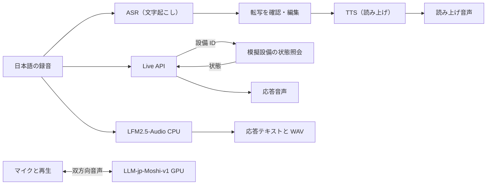

# 日本語の ASR（文字起こし）・TTS（読み上げ）・リアルタイム対話をローカルモデルとクラウド API で試す

日本語の短い音声を使い、**ASR（文字起こし）・TTS（読み上げ）・音声対話**を試す Tip。ローカルの CPU / GPU、Gemini API、OpenAI API について、モデルごとの入出力・量子化・検証結果をまとめる。

> **⚠️ 注意点**　ASR（文字起こし）は公開の日本語朗読 5 件、TTS（読み上げ）は短文 3 件で確認した。LLM-jp-Moshi-v1 の GPU 実行結果は **TBD**。

## 📑 目次

- [アーキテクチャ](#-アーキテクチャ)
- [比較対象のモデル](#-比較対象のモデル)
- [使用方法](#-使用方法)
- [実行結果](#-実行結果)
- [開発者向け情報](#-開発者向け情報)
- [注意点・課題](#-注意点課題)
- [参考サイト](#-参考サイト)

## 🏗️ アーキテクチャ

ASR（文字起こし）と TTS（読み上げ）を分けると、転写を確認・編集してから読み上げに渡せる。音声対話では、録音から応答を作る LFM2.5、マイクと応答音声を並行処理する Moshi、対話中に模擬設備の状態を照会する Gemini Live を試す。



## 🧩 比較対象のモデル

| モデル・エンジン | 用途 | 入力 → 出力 | 実行環境・ツール | 量子化の有無・形式 | 動作確認 |
| --- | --- | --- | --- | --- | --- |
| ReazonSpeech NeMo v2 | ASR（文字起こし） | WAV → テキスト | CPU / `speech.cpp` | あり（Q4_K） | CPU 実測 |
| Qwen3-ASR 0.6B | ASR（文字起こし） | WAV → テキスト | CPU / `speech.cpp` | あり（Q4_K） | CPU 実測 |
| Qwen3-ASR 1.7B | ASR（文字起こし） | WAV → テキスト | CPU / `speech.cpp` | あり（Q4_K / Q8_0） | CPU 実測 |
| Qwen3-TTS 0.6B | TTS（読み上げ） | テキスト → WAV | CPU / `speech.cpp` | あり（Q4_K） | CPU 実測 |
| Qwen3-TTS 1.7B | TTS（読み上げ） | テキスト → WAV | CPU / `speech.cpp` | あり（Q4_K / Q8_0） | CPU 実測 |
| VOICEVOX ENGINE 0.26.2 | TTS（読み上げ） | テキスト → WAV | CPU / Docker・HTTP API | 外部指定なし。内部形式は未確認 | CPU 実測 |
| LFM2.5-Audio-1.5B-JP | 録音からの音声応答 | WAV → テキストと応答 WAV | CPU / `llama-liquid-audio-cli` | あり（Q4_0） | CPU 実測 |
| LFM3-Audio-2B | ASR（文字起こし）・TTS（読み上げ） | WAV ↔ テキスト | CPU / `llama.cpp` | あり（本体 Q4_K_M、音声プロジェクタ Q8_0） | CPU 実測 |
| LLM-jp-Moshi-v1（7B） | 日本語の全二重対話 | 音声 ↔ 応答音声 | 公式構成は Linux / NVIDIA GPU（VRAM 24 GB 以上）。CPU は録音ファイル推論を検証 | 量子化なし（本体 BF16） | CPU で WAV 生成、GPU は **TBD** |
| `gemini-3.5-transcribe` | ASR（文字起こし） | 録音 → テキスト | Gemini API / Interactions API | 非公開 | 実 API で確認 |
| `gemini-3.8-flash-lite-tts` | TTS（読み上げ） | テキスト → WAV | Gemini API / Interactions API | 非公開 | 実 API で確認 |
| `gemini-3.8-live` | 音声対話とツール呼び出し | 音声 → 設備照会 → 応答音声 | Gemini API / Live API（WebSocket） | 非公開 | 実 API で確認 |
| `gpt-transcribe` | ASR（文字起こし） | 録音 → テキスト | OpenAI API / Audio API | 非公開 | 実 API で確認 |
| `gpt-realtime-2.1-mini` | TTS（読み上げ）・音声対話 | テキストまたは音声 → 応答音声 | OpenAI API / Realtime API（WebSocket） | 非公開 | 実 API で確認 |

## 🚀 使用方法

`audio_processing/2` で `make` を実行する。Python の仮想環境は [uv](https://docs.astral.sh/uv/) で管理する。タスク一覧は `make help` で確認できる。

### speech.cpp で ASR（文字起こし）と TTS（読み上げ）（CPU）

1. Linux x86-64 の作業ディレクトリで、`speech.cpp` v0.11.0 の CPU 版を展開する。配布バイナリには AVX2 / FMA / F16C 対応の CPU と glibc 2.34 以上が必要。再生・変換には `ffplay` / `ffmpeg` を使う。他の OS は [公式インストール手順](https://github.com/nyosegawa/speech.cpp/blob/v0.11.0/docs/install.md) を参照。

    ```sh
    make install-speech
    ./speech-cpp/speech --version
    make download-speech-models
    ```

1. Qwen3-TTS の日本語話者 `ono_anna` で入力用の WAV を生成する。取得する Q4_K の重みは 5 モデルで合計約 4.1 GB。`TTS_MODEL` で 0.6B と 1.7B を指定する。

    ```sh
    make tts TTS_MODEL=qwen3-tts-0.6b:q4_k TEXT='設備の状態を確認してください。' OUTPUT=sample.wav
    make tts TTS_MODEL=qwen3-tts-1.7b:q4_k TEXT='設備の状態を確認してください。' OUTPUT=qwen-tts-1.7b.wav
    ffplay -nodisp -autoexit sample.wav
    ```

1. 同じ WAV を 3 モデルで ASR（文字起こし）し、転写を元の発話と照合する。自分で録音した短い日本語 WAV でも比較できる。

    ```sh
    make asr AUDIO=sample.wav MODEL=reazonspeech-v2:q4_k
    make asr AUDIO=sample.wav MODEL=qwen3-asr-0.6b:q4_k
    make asr AUDIO=sample.wav MODEL=qwen3-asr-1.7b:q4_k
    ```

1. 公開音声で比較する。`make evaluate-asr` は Google FLEURS の日本語朗読をダウンロードし、3 モデルの転写と文字誤り率（CER）を表示する。音声は `_tmp/evaluate-asr/` に保存される。

    ```sh
    make evaluate-asr
    ffplay -nodisp -autoexit _tmp/evaluate-asr/fleurs-1607.wav
    ```

1. 量子化の影響を見る場合は、ASR（文字起こし）と TTS（読み上げ）の 1.7B モデルを、Q4_K に加えて Q8_0 でも実行する。Q8_0 は 8-bit 量子化で、取得する 2 ファイルは合計約 4.46 GB。`make evaluate-qwen-q8` は同じ朗読 5 件と同じ短文 3 件を使う。配布カタログに 1.7B の F16 は無く、今回の比較は Q8_0 まで実施した。 [speech.cpp のモデル取得仕様](https://github.com/nyosegawa/speech.cpp/blob/v0.11.0/docs/cli.md#speech-models)

    ```sh
    make download-qwen-q8
    make asr AUDIO=_tmp/evaluate-asr/fleurs-1607.wav MODEL=qwen3-asr-1.7b:q8_0
    make tts TTS_MODEL=qwen3-tts-1.7b:q8_0 TEXT='設備の状態を確認してください。' OUTPUT=qwen-tts-1.7b-q8.wav
    make evaluate-qwen-q8
    ```

### VOICEVOX ENGINE で TTS（読み上げ）（CPU）

1. Docker で CPU 版を起動する。

    ```sh
    make download-voicevox
    make serve-voicevox
    ```

1. 別のターミナルで `/version` の応答を確認し、話者スタイル ID `1` で読み上げる。`/audio_query` が生成した読みやアクセントの情報を `/synthesis` に渡す。話者スタイルの一覧は `/speakers` で取得できる。

    ```sh
    api=http://127.0.0.1:50021
    curl -fsS "$api/version"
    curl -fsS -X POST -G "$api/audio_query" \
        --data-urlencode 'speaker=1' --data-urlencode 'text=設備Bは点検中です。' \
        -o query.json
    curl -fsS -X POST "$api/synthesis?speaker=1" \
        -H 'Content-Type: application/json' --data-binary @query.json \
        -o voicevox.wav
    ffplay -nodisp -autoexit voicevox.wav
    ```

1. VOICEVOX を起動したまま、Qwen3-TTS の 0.6B / 1.7B と同じ 3 文を合成し、3 種の ASR（文字起こし）で再転写する。生成音声は `_tmp/evaluate-tts/` に保存される。

    ```sh
    make evaluate-tts
    ```

### LFM2.5-Audio-1.5B-JP で録音に応答（CPU）

1. Linux x86-64 上で、Liquid AI が配布しているランナーと 4 つの Q4_0 GGUF（合計約 1.1 GB）を取得する。以下では Docker の Ubuntu 24.04 で実行する。

    ```sh
    make download-lfm2
    ```

1. 短い日本語の録音を用意する。`make evaluate-asr` が保存した公開朗読も指定できる。`make lfm2-dialogue` は入力を 24 kHz / 16-bit / mono に変換し、応答テキストと WAV を出力する。

    ```sh
    make lfm2-dialogue AUDIO=_tmp/evaluate-asr/fleurs-1607.wav OUTPUT=lfm-reply.wav
    ffplay -nodisp -autoexit lfm-reply.wav
    ```

    生成トークンの上限は Makefile の `-n 128` で指定している。この CLI 手順では録音ごとに応答を生成する。

### LFM3-Audio-2B で ASR（文字起こし）と TTS（読み上げ）（CPU）

1. Ubuntu 24.04 x86-64 で `libgomp1` を用意し、`llama.cpp` b11960 と GGUF 2 ファイル（合計約 1.4 GB）を取得する。

    ```sh
    sudo apt install libgomp1
    make download-lfm3
    ```

1. 録音の ASR（文字起こし）と日本語の TTS（読み上げ）を実行する。LFM3 のモデルカードでは、音声対話と Live ASR（文字起こし）は英語対応。ここでは日本語のファイル入力と音声合成を試す。 [LFM3-Audio-2B の対応機能](https://huggingface.co/LiquidAI/LFM3-Audio-2B)

    ```sh
    make lfm3-asr AUDIO=_tmp/evaluate-asr/fleurs-1607.wav
    make lfm3-tts TEXT='設備の状態を確認してください。' OUTPUT=lfm3-tts.wav
    ffplay -nodisp -autoexit lfm3-tts.wav
    ```

### LLM-jp-Moshi-v1 で全二重対話（GPU）

1. NVIDIA GPU（VRAM 24 GB 以上、BF16 対応）を備えた Linux マシンで、`audio_processing/2` に移動する。`make install-moshi` で専用の仮想環境を作り、[`requirements-moshi.txt`](requirements-moshi.txt) をインストールする。モデルの初回取得には Hugging Face への接続とモデルファイル用に約 16 GB の空き容量が必要。

    ```sh
    nvidia-smi
    make install-moshi
    make download-moshi
    .venv-moshi/bin/python -c 'import torch; print(torch.cuda.get_device_name(0))'
    ```

1. [`run_moshi_gpu.sh`](run_moshi_gpu.sh) で公式の Web UI を起動する。モデルのロードとウォームアップが完了したらブラウザで `http://localhost:8998` を開き、マイクを許可してヘッドホンで応答を聞く。通常の発話に加え、モデルが話している間に話しかけて応答を確認する。

    ```sh
    make moshi-web
    ```

    GPU マシンがリモートの場合は、ブラウザを使う端末から `ssh -N -L 8998:127.0.0.1:8998 USER@GPU_HOST` で転送する。Web UI は認証なしで動作するため、ポート 8998 への外部からの直接アクセスはファイアウォールで閉じておく。

1. 録音ファイルで確認する場合は `wav` を使う。公式のファイル推論は入力の終端で止まるため、発話後の応答を収めるために末尾に無音を追加する。

    ```sh
    ffmpeg -i sample.wav -af apad=pad_dur=8 -ar 24000 -ac 1 -c:a pcm_s16le moshi-input.wav
    make moshi-wav AUDIO=moshi-input.wav OUTPUT=moshi-reply.wav
    ffplay -nodisp -autoexit moshi-reply.wav
    ```

### LLM-jp-Moshi-v1 の録音ファイル推論（CPU）

上流の `moshi.run_inference` は `--device cpu` を受け付ける。7B の重みを BF16 のまま載せるため、空き RAM を確認し、短い録音を使う。公式の対話手順は VRAM 24 GB 以上の GPU を想定している。今回の CPU 環境では 5.52 秒分の推論に 69 秒かかったため、ファイルベースでの確認に使った。

```sh
make install-moshi-cpu
make download-moshi MOSHI_PYTHON=.venv-moshi-cpu/bin/python
ffmpeg -i sample.wav -af apad=pad_dur=2.5 -ar 24000 -ac 1 -c:a pcm_s16le moshi-cpu-input.wav
make moshi-wav-cpu AUDIO=moshi-cpu-input.wav OUTPUT=moshi-cpu-reply.wav
ffplay -nodisp -autoexit moshi-cpu-reply.wav
```

### Gemini API で ASR（文字起こし）・TTS（読み上げ）・音声対話

1. `make setup` で [`.env.example`](.env.example) を `.env` にコピーし、`GEMINI_API_KEY` にキーを記入する。`.env` は Git の管理対象外。`make install` で [`requirements.txt`](requirements.txt) の依存をインストールする。 [Google AI Studio の API キー発行手順](https://aistudio.google.com/docs/api-key)

    ```sh
    make setup
    make install
    ```

1. 録音を ASR（文字起こし）し、内容を確認してから TTS（読み上げ）を実行する。`sample.wav` には自身の録音または上の手順で作ったファイルを指定する。ASR（文字起こし）の実行後、[`run.py`](run.py) はアップロードした音声ファイルを削除する。

    ```sh
    make gemini-asr AUDIO=sample.wav
    make gemini-tts TEXT='設備の状態を確認してください。' OUTPUT=gemini-tts.wav
    ffplay -nodisp -autoexit gemini-tts.wav
    ```

1. Live API のツール呼び出しを試す。「設備 B の状態を教えてください」と録音して `request.wav` にするか、Gemini の TTS（読み上げ）で生成する。Live API に渡す音声は 16 kHz / 16-bit / mono に変換する。

    ```sh
    make gemini-tts TEXT='設備 B の状態を教えてください。' OUTPUT=request.wav
    ffmpeg -i request.wav -ac 1 -ar 16000 -c:a pcm_s16le request-16k.wav
    make gemini-live AUDIO=request-16k.wav OUTPUT=gemini-live.wav
    ffplay -nodisp -autoexit gemini-live.wav
    ```

1. ターミナルに `lookup_equipment` の呼び出しと `B` / `点検中` の結果が表示され、音声でも同じ状態が伝わることを確認する。この例では録音 1 件を WebSocket で送り、ツールの応答を同じセッションに返す。マイクでの双方向会話は [Google AI Studio の Live 画面](https://aistudio.google.com/live?model=gemini-3.8-live) で試せる。

### OpenAI API で ASR（文字起こし）・TTS（読み上げ）・音声対話

1. `make setup` で `.env` を用意し、`OPENAI_API_KEY` を設定する。`make install` で Python SDK をインストールする。 [OpenAI API キー](https://platform.openai.com/api-keys)

    ```sh
    make setup
    make install
    ```

1. [`run_openai.py`](run_openai.py) は ASR（文字起こし）に `gpt-transcribe`、TTS（読み上げ）に Realtime API の `gpt-realtime-2.1-mini` を使う。 [OpenAI の音声 API](https://developers.openai.com/api/docs/guides/audio)・[TTS（読み上げ）の移行先](https://developers.openai.com/api/docs/guides/text-to-speech)

    ```sh
    make openai-asr AUDIO=sample.wav
    make openai-tts TEXT='設備 B の状態を教えてください。' OUTPUT=openai-request.wav
    ffplay -nodisp -autoexit openai-request.wav
    ```

1. 録音を 24 kHz / 16-bit / mono にそろえ、同じ Realtime モデルで設備照会を行う。クライアントで `lookup_equipment` の結果を返し、続く応答音声を WAV に保存する。

    ```sh
    ffmpeg -i openai-request.wav -ac 1 -ar 24000 -c:a pcm_s16le openai-request-24k.wav
    make openai-dialogue AUDIO=openai-request-24k.wav OUTPUT=openai-dialogue.wav
    ffplay -nodisp -autoexit openai-dialogue.wav
    ```

Claude にはアプリの音声モードがある。公開の Claude Messages API のモデルはテキスト・画像入力とテキスト出力に対応するため、アプリで音声を扱う場合は、外部の ASR（文字起こし）と TTS（読み上げ）で Claude のテキスト処理を挟む。 [Claude 音声モード](https://support.claude.com/en/articles/11101966-use-voice-mode)・[Claude API のモデル仕様](https://platform.claude.com/docs/en/models/overview)

## 📊 実行結果

✅ は各表の評価指標で実測値が最も良かったモデル。①は CER、②は 3 種の再転写 CER の平均、③は設備 ID と状態の一致率を使う。

### ① 日本語 ASR（文字起こし）の品質比較（公開朗読 5 件）

Google の FLEURS `ja_jp` validation の先頭 5 件（ID `1519` / `1608` / `1607` / `1634` / `1625`、計 63.96 秒、CC BY 4.0）を、同じ順序で 7 構成に入力した。ローカルは Linux x86-64、CPU 4 スレッド、`speech.cpp` v0.11.0 または `llama.cpp` b11960 を使用。Gemini と OpenAI は認証付き API で実行した。文字誤り率（CER）は参照文と転写の置換・削除・挿入の合計を参照文の文字数で割る。Unicode NFKC で正規化し、英字の大小を統一して句読点と空白を除き、全 5 件の文字数で集計した。 [Google FLEURS の日本語 validation](https://huggingface.co/datasets/google/fleurs/viewer/ja_jp/validation)・[CC BY 4.0](https://creativecommons.org/licenses/by/4.0/)

| モデル | CER（誤り文字数 / 参照文字数） | 完全一致 | 主な誤りの例 |
| --- | ---: | ---: | --- |
| ReazonSpeech NeMo v2（Q4_K） | 8.44%（20 / 237） | 1 / 5 | 「帰国後」→「企画後」、「価値」→「歌詞」 |
| Qwen3-ASR 0.6B（Q4_K） | 10.97%（26 / 237） | 0 / 5 | 「帰国後」→「企画後」、「本州列島」→「本州レッド」 |
| Qwen3-ASR 1.7B（Q4_K） | 3.80%（9 / 237） | 3 / 5 | 「飛び越えて」→「飛びこいて」、「聖歌」→「成果」 |
| Qwen3-ASR 1.7B（Q8_0） | 2.11%（5 / 237） | 3 / 5 | 「2人」→「二人」、「ヴェルサーチ」→「ベルサーチ」 |
| LFM3-Audio-2B（本体 Q4_K_M） | 6.33%（15 / 237） | 2 / 5 | 「興味」→「今日見」、「7,000」→「7千」 |
| ✅ `gemini-3.5-transcribe` | **1.69%（4 / 237）** | 4 / 5 | 「はぐれて」→「離れて」、「ヴェルサーチ」→「ベルサーチ」 |
| `gpt-transcribe` | 4.64%（11 / 237） | 3 / 5 | 「車椅子」→「車いす」、「シュリーシャム」→「首里シャム」 |

ローカルでは Qwen3-ASR 1.7B（Q8_0）の CER が最も低かった。同じ 1.7B の Q4_K と比べて誤りが 9 文字から 5 文字に減り、完全一致はどちらも 3 件だった。

### ② 日本語 TTS（読み上げ）の品質比較（短文 3 件の再転写）

7 構成で「設備の状態を確認してください。」「設備Bは点検中です。」「期限は明日の午後五時です。」を生成し、同じ 3 種のローカル ASR（文字起こし）で再転写した。Qwen3-TTS は `ono_anna`・seed `42`、VOICEVOX ENGINE 0.26.2 は話者スタイル ID `1`、LFM3 は `ja`・`female`・seed `42`、Gemini は `Kore`、OpenAI は `marin` を使用。CER は①と同じ正規化で算出した。

| モデル・エンジン | ReazonSpeech での CER | Qwen3-ASR 0.6B での CER | Qwen3-ASR 1.7B（Q4_K）での CER | 平均 CER |
| --- | ---: | ---: | ---: | ---: |
| Qwen3-TTS 0.6B（Q4_K） | **2.86%（1 / 35）** | 22.86%（8 / 35） | 2.86%（1 / 35） | 9.52% |
| Qwen3-TTS 1.7B（Q4_K） | 45.71%（16 / 35） | 37.14%（13 / 35） | 14.29%（5 / 35） | 32.38% |
| Qwen3-TTS 1.7B（Q8_0） | 60.00%（21 / 35） | 17.14%（6 / 35） | 17.14%（6 / 35） | 31.43% |
| VOICEVOX ENGINE | 71.43%（25 / 35） | 20.00%（7 / 35） | 14.29%（5 / 35） | 35.24% |
| LFM3-Audio-2B（本体 Q4_K_M） | 68.57%（24 / 35） | 20.00%（7 / 35） | 11.43%（4 / 35） | 33.33% |
| ✅ `gemini-3.8-flash-lite-tts` | 11.43%（4 / 35） | 8.57%（3 / 35） | 2.86%（1 / 35） | **7.62%** |
| `gpt-realtime-2.1-mini` | 22.86%（8 / 35） | **2.86%（1 / 35）** | **0.00%（0 / 35）** | 8.57% |

再転写に使う ASR（文字起こし）によって順位が変わった。Qwen3-TTS 1.7B の Q8_0 は、Q4_K より Qwen3-ASR 0.6B での CER が低くなり、他の 2 種での CER は上がった。CER には「五」→「5」などの表記差や転写モデル自体の誤りも入る。人による自然さ・発音の評価は未実施。

### ③ 音声対話の品質比較（設備 ID・状態の一致率）

「設備 A は稼働中です。設備 A の状態を一言で教えてください」と、設備 B / 点検中に置き換えた 2 件を Qwen3-TTS 0.6B で合成した。同じ発話を各モデルに入力し、出力 WAV を `gemini-3.5-transcribe` で転写して **設備 ID** と **状態** を各 1 点で照合した。満点は 4 点。Gemini Live と OpenAI Realtime は照会ツールで状態を取得できる構成で、LFM2.5 と Moshi は発話に含まれる状態を使う。Moshi では録音の末尾に 2.5 秒の無音を加えた。

| モデル | 必須情報の一致 | 2 項目とも正しい発話 | 実行結果の例 |
| --- | ---: | ---: | --- |
| LFM2.5-Audio-1.5B-JP（Q4_0） | 75%（3 / 4） | 1 / 2 | B の「点検中」は一致。A の応答では設備 ID が B に変わった |
| ✅ `gemini-3.8-live` | **100%（4 / 4）** | 2 / 2 | ツールで A を稼働中、B を点検中と照会し、応答音声でも一致 |
| ✅ `gpt-realtime-2.1-mini` | **100%（4 / 4）** | 2 / 2 | ツールで A を稼働中、B を点検中と照会し、応答音声でも一致 |
| LLM-jp-Moshi-v1（CPU、BF16） | 0%（0 / 4） | 0 / 2 | 2 件とも WAV を生成。出力の転写から該当する設備 ID や状態を確認できなかった |
| LLM-jp-Moshi-v1（GPU、BF16） | **TBD** | **TBD** | Web UI と WAV 推論の起動引数を公式実装と照合 |

別の動作テストでは、LFM2.5 が FLEURS ID `1607` の「村を30分ほど散策する」という話題に沿って 5.90 秒の WAV を生成した。Gemini Live では「設備 B の状態を教えてください」という録音を送り、2.84 秒の WAV から「設備Bは現在点検中です。」と転写できた。Gemini の実 API テストには `google-genai` 2.25.0 を使用した。

LLM-jp-Moshi-v1 は Xeon 2.30 GHz の CPU 4 スレッド、BF16、`moshi` 0.2.2 で動作した。無音を足した入力から 5.52 秒の 24 kHz WAV を生成。推論ループは 69 秒、モデルの読み込みを含む実行全体は 207 秒だった。

OpenAI SDK 3.55.0 を用い、実 API で FLEURS 5 件の ASR（文字起こし）、短文 3 件の TTS（読み上げ）、設備照会と応答 WAV の生成を確認した（2026-11-19 UTC）。

## 🛠️ 開発者向け情報

### 📁 ディレクトリ構成

```text
audio_processing/2/
├── .env.example            # Git 管理する Gemini / OpenAI キー設定例
├── Makefile                 # セットアップ、実行、音声品質比較
├── README.md
├── requirements.txt         # Gemini API と OpenAI API の Python 依存
├── run.py                   # Gemini の ASR（文字起こし）、TTS（読み上げ）、Live API
├── run_openai.py            # OpenAI の ASR（文字起こし）、TTS（読み上げ）、Realtime API
├── evaluate_cpu.py          # 日本語朗読と合成音声の文字誤り率を集計
├── requirements-moshi.txt   # LLM-jp-Moshi-v1 の Python 依存
└── run_moshi_gpu.sh         # 公式 Web UI と WAV 推論の起動
```

### 🔑 コードの主なポイント

- [`run.py`](run.py) は音声を Live API に送信し、設備照会の結果を同じセッションに返す。応答音声は WAV に保存する。
- [`run_openai.py`](run_openai.py) は Audio API に録音を送って転写し、Realtime API から受信する PCM 差分をまとめて WAV に保存する。
- [`evaluate_cpu.py`](evaluate_cpu.py) は同じ入力を 3 種の ASR（文字起こし）に渡し、文字編集距離を参照文の文字数で割って CER を集計する。
- [`run_moshi_gpu.sh`](run_moshi_gpu.sh) は `web` で `moshi.server`、`wav` で `moshi.run_inference` を同じ日本語モデルに切り替えて起動する。

### 🧰 利用可能コマンド（`make <target>`）

| コマンド | 用途 |
| --- | --- |
| `make help` | 全タスクを表示 |
| `make setup install` | クラウド API 用の `.env` を用意し、依存をインストール |
| `make install-speech` / `make download-speech-models` | speech.cpp と ReazonSpeech・Qwen3 の重みを取得 |
| `make asr` / `make tts` | speech.cpp で ASR（文字起こし）・TTS（読み上げ） |
| `make download-voicevox` / `make serve-voicevox` | VOICEVOX ENGINE の CPU 版を取得・起動 |
| `make download-lfm2` / `make lfm2-dialogue` | LFM2.5 日本語版の取得・録音からの応答 |
| `make download-lfm3` / `make lfm3-asr` / `make lfm3-tts` | LFM3 の取得・ASR（文字起こし）・TTS（読み上げ） |
| `make evaluate-asr` / `make evaluate-tts` | 公開朗読の ASR（文字起こし）と合成音声の再転写を評価 |
| `make download-qwen-q8` / `make evaluate-qwen-q8` | Qwen3 1.7B の Q8_0 版を取得・評価 |
| `make gemini-asr` / `make gemini-tts` / `make gemini-live` | Gemini API の 3 モードを実行 |
| `make openai-asr` / `make openai-tts` / `make openai-dialogue` | OpenAI API の 3 モードを実行 |
| `make install-moshi` / `make download-moshi` | Moshi の GPU 環境構築と重みの取得 |
| `make moshi-web` / `make moshi-wav` | Moshi の GPU 実行 |
| `make install-moshi-cpu` / `make moshi-wav-cpu` | Moshi の CPU 環境構築と録音ファイル推論 |

## ⚠️ 注意点・課題

- **ASR（文字起こし）の比較**では、各モデルに同じ録音を渡し、固有名詞・英数字・時刻・言い直しの保持を確認する。「設備 A、違う、設備 B です」のような録音では、文字起こし結果と照会ツールに渡った設備 ID をそれぞれ見る。
- **TTS（読み上げ）の遅延**は、最初の音声が聞こえるまでと最後まで生成する時間を分けて測る。計測条件には、モデルの初回ダウンロードやロード時間を含むかも記録する。
- **音声対話の中断**では、音声再生の中断とツール処理の取消を個別に扱う。確定結果はツールから取得して利用者に伝える。長い処理を会話と並行して実行する場合は Live API の非同期 function calling を利用できる。

## 🔗 参考サイト

- [speech.cpp v0.11.0 リリース](https://github.com/nyosegawa/speech.cpp/releases/tag/v0.11.0)
- [speech.cpp CLI リファレンス](https://github.com/nyosegawa/speech.cpp/blob/v0.11.0/docs/cli.md)
- [Qwen3-ASR の公式実装](https://github.com/QwenLM/Qwen3-ASR)
- [Qwen3-TTS の公式実装](https://github.com/QwenLM/Qwen3-TTS)
- [Google FLEURS データセット](https://huggingface.co/datasets/google/fleurs)（[CC BY 4.0](https://creativecommons.org/licenses/by/4.0/)）
- [FLEURS の論文](https://arxiv.org/abs/2205.12446)
- [VOICEVOX ENGINE](https://github.com/VOICEVOX/voicevox_engine)
- [Liquid AI の LFM2.5-Audio-1.5B-JP GGUF・実行手順](https://huggingface.co/LiquidAI/LFM2.5-Audio-1.5B-JP-GGUF)
- [Liquid AI の LFM3-Audio-2B GGUF・実行手順](https://huggingface.co/LiquidAI/LFM3-Audio-2B-GGUF)
- [LLM-jp-Moshi-v1 のモデルカード・実行要件](https://huggingface.co/llm-jp/llm-jp-moshi-v1/blob/main/README-en.md)
- [Kyutai の Moshi PyTorch 実装](https://github.com/kyutai-labs/moshi/tree/main/moshi)
- [Gemini API の ASR（文字起こし）](https://aistudio.google.com/docs/transcribe)
- [Gemini API の TTS（読み上げ）](https://aistudio.google.com/docs/speech-generation)
- [Gemini Live API の音声入出力](https://aistudio.google.com/docs/live-api/capabilities)
- [Gemini Live API のツール呼び出し](https://aistudio.google.com/docs/live-api/tools)
- [OpenAI の GPT-Transcribe](https://developers.openai.com/api/docs/models/gpt-transcribe)
- [OpenAI の Realtime 音声対話](https://developers.openai.com/api/docs/guides/realtime-conversations)
- [Claude Messages API](https://platform.claude.com/docs/en/api/messages/create)
