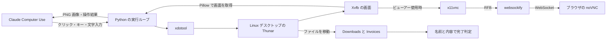
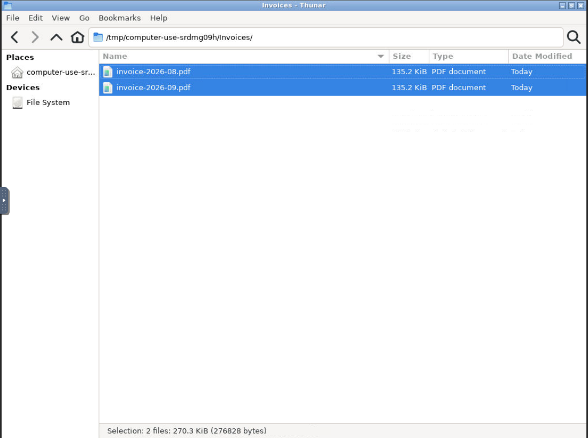
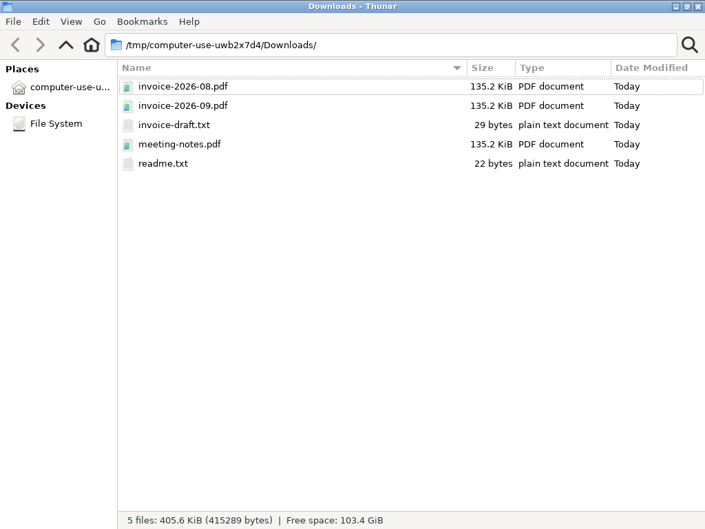
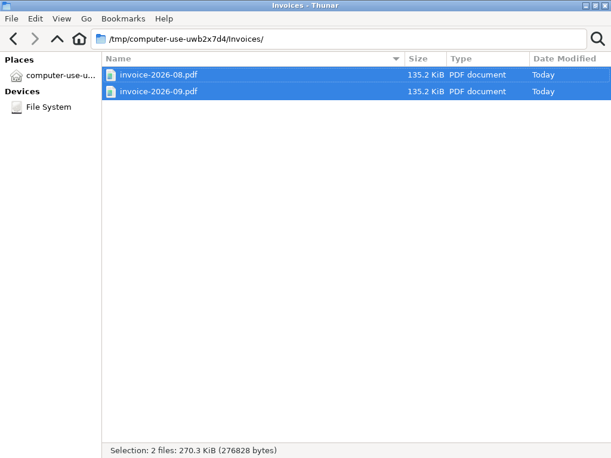

# Claude の Computer Use を使用してコンピューター上の操作を行う

Docker 内の Linux デスクトップで、Xfce のファイルマネージャー **Thunar** を操作する。`Downloads` にある `invoice-` で始まる PDF を `Invoices` に移動し、対象外のファイルが元の場所に残っているかを検証する。

## 📑 目次

- [アーキテクチャ](#-アーキテクチャ)
- [使用方法](#-使用方法)
- [実行結果](#-実行結果)
- [開発者向け情報](#-開発者向け情報)
    - [リモートデスクトップの配信方式](#-リモートデスクトップの配信方式)
- [参考サイト](#-参考サイト)

## 🏗️ アーキテクチャ



Linux コンテナでは Xvfb に描画された画面全体を取得し、Openbox 上で動く Thunar にマウスとキーボードの入力を送る。操作対象と出力は各試行で用意する。模擬ファイルはコンテナ内の一時ディレクトリに生成し、ホストにはスクリーンショットと検証結果を保存する。

### 仕分けの条件

| 初期ファイル | 実行後のフォルダー |
| --- | --- |
| `invoice-2026-08.pdf`、`invoice-2026-09.pdf` | `Invoices` |
| `invoice-draft.txt`、`meeting-notes.pdf`、`readme.txt` | `Downloads` |

## 🚀 使用方法

### Claude の操作をブラウザで見る

1. Linux デスクトップ用のイメージをビルドし、`.env` を用意する。Docker Compose v2 と GNU Make を使用する。Python の依存は uv が `uv.lock` から同期する

    ```sh
    cd nlp_processing/74
    make install
    make setup
    ```

    `.env` の `ANTHROPIC_API_KEY` に Claude API キーを設定する。`.env` は Git の除外対象。

1. Linux 画面を起動する。表示された URL をブラウザで開くと、ファイルマネージャー Thunar の `Downloads` を確認できる

    ```sh
    make run
    ```

    既定の URL は `http://127.0.0.1:6080/vnc.html?autoconnect=1&view_only=1&resize=scale`。ポートを変更する場合は `make run VIEW_PORT=16080` を使う。ブラウザでは閲覧でき、Claude が操作を始めるまで待機する。

1. Claude にテキスト指示を送る。ブラウザでファイルの選択やフォルダー移動を見られる

    ```sh
    make send-message MESSAGE='Thunar の画面で Downloads を確認し、ファイル名が invoice- で始まる PDF だけを Invoices に移動してください。残りのファイルは Downloads に置いたままにしてください。'
    ```

    `MESSAGE` を省略すると、実演用の指示が送られる。これに操作対象のパスやキー入力の書式が加わる。以下は省略時に実際に送られるテキストで、`{downloads}` と `{invoices}` にはコンテナ内のパスが入る。[`run.py`](run.py)

    ```text
    Thunar の画面で Downloads を確認し、ファイル名が invoice- で始まる PDF だけを Invoices に移動してください。
    残りのファイルは Downloads に置いたままにしてください。

    Downloads のパスは {downloads}、Invoices のパスは {invoices} です。
    最初にスクリーンショットを取得し、移動後に Invoices の中身を確認してください。
    Ctrl+S（パターンで選択）、Ctrl+X、Ctrl+L、Ctrl+V を使用できます。
    key 操作の text には、Control_L+s や Return などの X11 キー名を指定してください。
    type 操作に指定できるのは invoice-*.pdf または対象フォルダーの正確なパスです。
    操作は Thunar 内で行い、最後に Invoices を表示してください。
    ```

    実演の判定条件は請求書 PDF 2 件の移動。指示は起動ごとに 1 回送れる。`make send-message` は実行結果と画像の保存先を表示する。標準モデルは `claude-sonnet-4-6`。モデルと API 呼び出し回数の上限（既定値 20）は起動時に `MODEL` と `MAX_TURNS` で指定できる。

1. ブラウザで `Invoices` を確認し、Linux 画面を終了する。最初からやり直すときは、終了後に `make run` を実行する

    ```sh
    make stop
    ```



### ブラウザから Linux を手動で操作する

1. `make setup` で用意した `.env` に、半角英数字 8 文字の `NOVNC_PASSWORD` を設定して手動モードを起動する。VNC 認証は先頭 8 文字を使う。[x11vnc のパスワード仕様](https://manpages.debian.org/bookworm/x11vnc/x11vnc.1.en.html)

    ```sh
    make run MODE=manual
    ```

1. `noVNC is ready` が出たら、表示された URL をブラウザで開き、`NOVNC_PASSWORD` を入力する

1. `Downloads` で `invoice-2026-08.pdf` をクリックし、`Shift+↓` で `invoice-2026-09.pdf` も選択する。`Ctrl+X` で切り取り、ツールバーの上向き矢印で親フォルダーに移動する。`Invoices` をダブルクリックで開き、`Ctrl+V` で貼り付ける。残りの 3 ファイルは `Downloads` に置いたままにする

1. 手動モードを起動したターミナルで Enter を押す。対象の PDF だけを移動できていれば `result.json` に `success: true` が記録される

### API キーなしで GUI の自動操作を見る

1. デモモードを起動して、表示された URL をブラウザで開く

    ```sh
    make run MODE=demo VIEW=1
    ```

1. `Downloads` が表示されたらターミナルで Enter を押す。Thunar が `Ctrl+S` で `invoice-*.pdf` を選択して対象を切り取り、`Invoices` に貼り付ける。`Run finished` の表示後、もう一度 Enter を押して結果を保存する

### リモートホストの Linux 画面を開く

1. リモートホストで Linux 画面を起動し、手元の端末から SSH でポートを転送する。`user@docker-host` は自分の SSH 接続先に置き換える

    ```sh
    ssh -N -L 127.0.0.1:6080:127.0.0.1:6080 user@docker-host
    ```

    リモート側の起動時に `VIEW_PORT` を変えた場合は、`-L` の両方のポート番号を同じ値に変える。

1. 手元のブラウザで起動時に表示された URL を開く

手動モードではブラウザからマウスとキーボードの入力を受け付ける。Claude とデモのライブ表示は閲覧専用。クリップボードの転送は全モードで無効。ビューアーはホストの `127.0.0.1` に公開し、Docker Engine 28.0.0 以降の標準ネットワーク設定ではホスト自身からアクセスできる。[x11vnc のマニュアル](https://manpages.debian.org/bookworm/x11vnc/x11vnc.1.en.html) · [Docker のポート公開](https://docs.docker.com/engine/network/port-publishing/)

## 📊 実行結果

Claude の実行では `make send-message` が `out/desktop-claude/run.*/` に結果を保存する。`MODE` を指定して直接起動した場合は `make run` がモード別の出力先に保存する。出力は `before.png`、`after.png`、`result.json`。

| モード | 1 回の実行結果 | 操作開始から検証までの所要時間 |
| --- | --- | --- |
| `demo` | PDF 2 件を移動し、対象外の 3 件を保持 | 3.3 秒 |
| `claude`（`claude-sonnet-4-6`） | PDF 2 件を移動し、対象外の 3 件を保持 | 43.2 秒 |

成功時は `result.json` の `success` が `true` になる。仕分け後の配置と各ファイルの内容が期待値に一致するかで判定する。以下は実際の Claude API を使った試行のスクリーンショット。

| 操作前の Downloads | 操作後の Invoices |
| --- | --- |
|  |  |

## 🛠️ 開発者向け情報

### 📁 ディレクトリ構成

```text
nlp_processing/74/
├── .env.example          # Claude API キーと noVNC パスワードの設定例
├── Makefile              # セットアップ、ビルド、操作テスト
├── Dockerfile            # Debian、Xvfb、Openbox、Thunar、noVNC
├── docker-compose.yml    # 操作用コンテナと実行結果の出力先
├── pyproject.toml        # Python の依存宣言
├── uv.lock               # uv のロックファイル
├── README.md
├── run.py                # 実行ループ、模擬データ生成、完了判定
└── images/               # 実行前後のスクリーンショット
```

### 🔑 コードの主なポイント

- [`run.py`](run.py) の `Desktop` は、Pillow の `ImageGrab` で Xvfb の 1024 × 768 の画面を取得する。`xdotool` に渡す座標を画面内に制限し、入力するキーと文字列はこのタスクで使用するものに絞る。
- Claude に渡す操作手段は画面取得と GUI 入力。仕分けの採点は実行側が行い、`Downloads` と `Invoices` のファイル名・内容を照合する。

### 🧰 利用可能コマンド（`make <target>`）

| コマンド | 用途 |
| --- | --- |
| `make help` | タスク一覧を表示 |
| `make setup` | `.env` が無ければ設定例から作成 |
| `make install` | Linux デスクトップと uv の Python 環境を含むイメージをビルド |
| `make run` | ブラウザで閲覧できる Linux 画面を起動 |
| `make send-message MESSAGE='…'` | 起動済みの画面で Claude に指示を送る。`MESSAGE` は省略可 |
| `make stop` | Linux 画面を終了 |
| `make run MODE=demo` | 決められた GUI 操作で仕分ける |
| `make run MODE=claude` | Claude が画面を見て操作を選ぶ |
| `make run MODE=manual` | ブラウザから Linux のマウスとキーボードを操作する |
| `make run MODE=demo VIEW=1` | ブラウザで GUI 操作をライブ表示する |

### 🔍 リモートデスクトップの配信方式

| 方式 | 仕組み | 適した用途 |
| --- | --- | --- |
| VNC（RFB）＋ WebSocket | デスクトップの画面更新を RFB で送り、websockify でブラウザ用の WebSocket に変換する | 既存の X11 セッションをブラウザで閲覧・操作する。[RFC 6143（Informational）](https://www.rfc-editor.org/rfc/rfc6143) · [noVNC](https://github.com/novnc/noVNC) |
| RDP / VNC ＋ ブラウザゲートウェイ | Apache Guacamole のサーバーが RDP や VNC への接続を仲介し、ブラウザに画面を転送する | Windows と Linux など複数の接続先を一つの入口に集約する。[Microsoft RDP 仕様](https://learn.microsoft.com/en-us/openspecs/windows_protocols/ms-rdpbcgr/5073f4ed-1e93-45e1-b039-6e30c385867c) · [Guacamole のアーキテクチャ](https://guacamole.apache.org/doc/gug/guacamole-architecture.html) |
| WebRTC | デスクトップを映像として符号化し、WebRTC で配信する | 動きが多い画面を低遅延で配信する。[W3C WebRTC 勧告](https://www.w3.org/TR/webrtc/) · [Selkies の WebRTC モード](https://docs.selkies.io/latest/design/) |
| 映像 ＋ WebSocket | 符号化した映像を WebSocket で送り、ブラウザ側で WebCodecs などを使って復号する | 映像と入力などを単一の WebSocket 接続で扱う。[Selkies の既定の配信方式](https://docs.selkies.io/latest/design/) |

この Tip では、既存の Xvfb をそのまま使ってファイル選択やフォルダー遷移を見せられる VNC ＋ noVNC を使う。利用者を限定してインターネット越しに見せる構成では、認証付きのゲートウェイと HTTPS/WSS を設けて接続権限を管理する。[Guacamole の TLS 終端](https://guacamole.apache.org/doc/gug/reverse-proxy.html)

## 🔗 参考サイト

- [Claude Platform Docs / Computer use tool](https://platform.claude.com/docs/en/agents-and-tools/tool-use/computer-use-tool#the-computing-environment)
- [Xfce / Thunar のファイルとフォルダーの操作](https://docs.xfce.org/xfce/thunar/working-with-files-and-folders)
- [Debian / xvfb-run](https://manpages.debian.org/bookworm/xvfb/xvfb-run.1.en.html)
- [Pillow / ImageGrab](https://pillow.readthedocs.io/en/stable/reference/ImageGrab.html)
- [xdotool](https://github.com/jordansissel/xdotool)
- [noVNC / ブラウザ表示の設定](https://github.com/novnc/noVNC/blob/v1.6.0/docs/EMBEDDING.md)
- [websockify](https://github.com/novnc/websockify)
- [RFC 6455 / The WebSocket Protocol](https://www.rfc-editor.org/rfc/rfc6455)
- [uv / Using uv in Docker](https://docs.astral.sh/uv/guides/integration/docker/)
