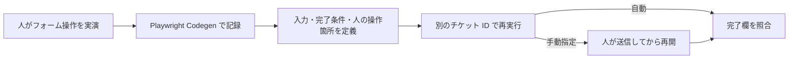

# Playwright Codegen を使用して、Grok Bot の Teach a task のようなブラウザ操作の記録・再実行を試す

Grok Bot の **Teach a task** ではブラウザ操作の実演からスキルの下書きを作成し、**Take over** では途中の操作を人が引き継ぐ。同じ流れを [ローカルの模擬フォーム](sandbox.html) で試す。Playwright Codegen で操作を Python コードとして記録し、入力と完了条件を追加して別のチケットでも再実行できるようにする。

製品の画面で試す手順は [Tip 76 の Grok Bot ハンズオン](../76/README.md) を参照。

## 📑 目次

- [アーキテクチャ](#-アーキテクチャ)
- [使用方法](#-使用方法)
- [実行結果](#-実行結果)
- [実演をスキルとして再利用する](#実演をスキルとして再利用する)
- [開発者向け情報](#-開発者向け情報)
- [参考サイト](#-参考サイト)

## 🏗️ アーキテクチャ



## 🚀 使用方法

### 別の入力で自動再実行する（コンテナ）

1. Docker Compose v2 と GNU Make が使える環境で、イメージをビルドする

    ```sh
    cd nlp_processing/75
    make setup install
    ```

    `.env` の `TICKET_ID` が既定のチケット ID になる。初期値は `DEMO-042`。

1. コンテナ内の Chromium で入力・送信・完了判定を行う。ID は `make` の引数で上書きできる

    ```sh
    make replay
    make replay TICKET_ID=DEMO-137 SHIFT_LAYOUT=1
    ```

    [`replay.py`](replay.py) はラベルとロールからフォームを操作する。`SHIFT_LAYOUT=1` でフォームを右に移した場合も `Saved: <入力した ID>` を照合する。

### 実演を記録し、人に操作を引き継ぐ（ホストの GUI）

1. GUI を表示できる環境で、uv の Python 環境と Chromium を用意する

    ```sh
    make install-local
    ```

    既定は Python 3.12。Linux で Chromium の OS 依存ライブラリが不足している場合は `uv run --locked --python 3.12 python -m playwright install --with-deps chromium` を実行する。

1. 実演を記録する

    ```sh
    make codegen
    ```

    Chromium の `Ticket ID` 欄に `DEMO-042` を入力して `Submit` を押す。Playwright Inspector に Python コードが表示される。Codegen のブラウザを閉じると、記録を `make replay-recorded` で再生できる。

1. 送信の操作を人に引き継ぐ

    ```sh
    make manual TICKET_ID=DEMO-207
    ```

    スクリプトが ID を入力して停止したら、Chromium で `Submit` を押し、Playwright Inspector の `Resume`（緑色の再生アイコン）を押す。送信せずに再開すると照合が失敗し、`make` はエラーを返す。

## 📊 実行結果

| 操作 | 確認する結果 |
| --- | --- |
| `make replay TICKET_ID=DEMO-137 SHIFT_LAYOUT=1` | コンテナから `Saved: DEMO-137` が出力される |
| `make replay-recorded` | 記録時の ID 入力と送信が再現される |
| `make manual TICKET_ID=DEMO-207` | 人が送信してから再開すると `Saved: DEMO-207` が出力される |

## 実演をスキルとして再利用する

実演の記録には、入力例や操作順が入る。再利用時に必要な判断と結果の検証を別途記述する。今回の例では次の項目を定義した。

| 項目 | 模擬フォームの例 |
| --- | --- |
| 使う場面 | デモチケットを登録するとき |
| 入力とアクセス | `DEMO-000` 形式の ID とローカルの模擬フォーム |
| 手順 | ID を入力し、`Submit` を押す |
| 完了条件 | 完了欄に入力 ID と一致する `Saved: <ID>` が表示される |
| 返す内容 | 照合した完了メッセージと終了コード |
| 人が行う操作 | `make manual` 実行時の送信と再開 |

- **資格情報が必要な場合**は、実演や生成コードの入力値に資格情報を含めず、人が必要な箇所だけ操作する。Grok Bot の Vault や Secure Form は、ログイン値をモデルに渡さずに入力する機能の例。
- **ブラウザの状態**は、サンプルでは起動ごとに初期化する。Grok Bot のコンピューターではログイン状態を保持し、同じユーザーの Bot 間でブラウザセッションを共有する。実演時と再実行時で初期状態が変わりうる場合は、開始前に必要な状態を確認する。
- **定期実行にする場合**は、自動モードをスケジューラーから呼び出し、終了コードと完了条件を記録する。実際のデータを更新するタスクでは、再試行の前に既存結果を確認し、同一の処理を重複実行しないようにする。人の操作が必要なタスクでは、停止と再開を記録できる起動方法を選ぶ。

## 🛠️ 開発者向け情報

### 📁 ディレクトリ構成

```text
nlp_processing/75/
├── .env.example          # 再実行するチケット ID の設定例
├── Makefile              # ビルド・再実行・実演・引き継ぎ
├── Dockerfile            # Chromium と uv の Python 環境
├── docker-compose.yml    # コンテナでの自動再実行
├── pyproject.toml        # Python の依存宣言
├── uv.lock               # uv のロックファイル
├── README.md
├── replay.py             # チケット入力、送信、結果の照合
└── sandbox.html          # チケット送信用の模擬フォーム
```

### 🔑 コードの主なポイント

- Codegen、コンテナ内での再実行、ホストでの操作引き継ぎは、同じ [模擬フォーム](sandbox.html) を使う。
- [`replay.py`](replay.py) に位置引数で ID を渡すと `TICKET_ID` より優先される。

### 🧰 利用可能コマンド（`make <target>`）

| コマンド | 用途 |
| --- | --- |
| `make help` | タスク一覧を表示 |
| `make setup install` | `.env` を用意してイメージをビルド |
| `make replay` | コンテナで検証付きの自動再実行 |
| `make install-local` | ホストで実演と引き継ぎを行う環境を用意 |
| `make codegen` / `make replay-recorded` | ホストで記録と再生 |
| `make manual` | ホストの GUI で人に送信を引き継ぐ |

## 🔗 参考サイト

- [Grok Bot / Skills and routines](https://docs.x.ai/grok-bot/skills-routines-and-automations)
- [Grok Bot / Use the computer and apps](https://docs.x.ai/grok-bot/computer-and-apps)
- [Grok Bot / Vault and secure sign-in](https://docs.x.ai/grok-bot/vault)
- [Playwright / Test generator](https://playwright.dev/python/docs/codegen)
- [Playwright / page.pause()](https://playwright.dev/python/docs/api/class-page#page-pause)
- [Playwright / Docker](https://playwright.dev/python/docs/docker)
- [uv / Running commands](https://docs.astral.sh/uv/concepts/projects/run/)
