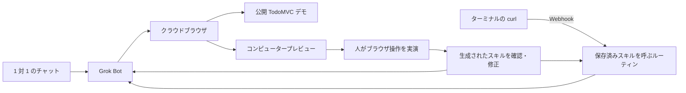
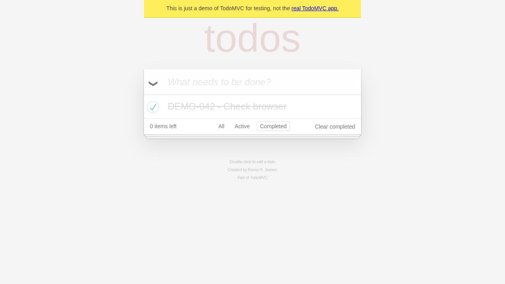

# Grok Bot の Computer Use と Teach a task でブラウザ操作を再実行する

Grok Bot のクラウドブラウザで、公開の TodoMVC デモに架空のタスクを追加して完了にする。右パネルで操作を確認し、自分で実演した手順をスキルにして別のタスク名で再実行する。TodoMVC デモへのログインは不要。Grok Bot の利用には対応するアカウントが必要。

## 📑 目次

- [アーキテクチャ](#-アーキテクチャ)
- [使用方法](#-使用方法)
    - [デスクトップアプリで行う場合](#デスクトップアプリで行う場合)
    - [CLI で行う場合](#cli-で行う場合)
- [実行結果の確認](#-実行結果の確認)
- [参考サイト](#-参考サイト)

## 🏗️ アーキテクチャ



## 🚀 使用方法

### デスクトップアプリで行う場合

#### Computer Use でデモを操作する

1. [Grok Bot](https://x.ai/bot) のデスクトップアプリをインストールしてサインインし、Bot との 1 対 1 の会話を開く

1. 次の依頼を送信し、会話右側のコンピュータープレビューでクリックや入力の様子を確認する

    ```text
    クラウドブラウザで https://demo.playwright.dev/todomvc/ を開いてください。
    All が表示されていれば開き、「DEMO-001 - Check browser」と完全に一致する項目を探してください。
    一致がなければ、「What needs to be done?」にその名前を入力して Enter を押してください。
    一致が1件ならその項目を使い、複数あれば操作せず報告してください。
    すでに完了済みの項目は状態を変えないでください。
    対象項目だけを完了にして、Completed に表示されることを確認してください。
    確認できた項目名と結果を返してください。ほかの項目は操作しないでください。
    ```

    <!-- TODO: Grok Bot の会話右側に操作中のコンピュータープレビューが見える画面を貼り付け -->
    

#### Teach a task で実演し、別の入力で再実行する

1. 同じ会話のコンピューター画面を開き、`Teach a task` を選ぶ。実演の目的を「新規のデモチケットを登録し、完了状態を確認する」と入力する

1. TodoMVC の `All` を開き、`What needs to be done?` 欄に `DEMO-042 - Check browser` と入力して Enter を押す。追加した行のチェックボックスを押し、`Completed` に表示されたら録画を止める

1. 生成されたスキルの下書きを確認し、`TodoMVC チケット完了` として保存する

    | 確認する項目 | スキルに記載する内容 |
    | --- | --- |
    | 入力 | 実演に使った固定文字列をタスク名の引数にする |
    | 操作対象 | 公開 TodoMVC デモと指定のタスク名に限定する |
    | 重複と再実行 | 同名の項目が1件なら再利用し、すでに完了していれば状態を変えない。複数件あれば停止する |
    | 完了判定 | `Completed` に対象タスクが表示されることを確認する |
    | 結果 | 完了を確認できたタスク名、または失敗した手順を返す |

    `Teach a task` が表示されない場合は、上の手順を Bot に渡し、最初に実行した操作と合わせてスキルを保存するよう依頼する。公式ドキュメントでは実演によるスキル作成は段階的に提供される。 [Grok Bot / Skills and routines](https://docs.x.ai/grok-bot/skills-routines-and-automations)

1. チャットでスキル名を指定して再実行する

    ```text
    スキル「TodoMVC チケット完了」を使って、
    「DEMO-137 - Verify replay」を登録して完了にしてください。
    Completed でその項目を確認し、結果を返してください。
    ```

#### 操作を人が引き継ぐ

1. 練習用に、「`DEMO-207 - Manual handoff` を追加したところで一旦停止し、完了チェックは人が行う」と Bot に伝える

1. 停止したらコンピュータープレビューを開く。操作を引き継げる場合は、対象行のチェックを人が付けてから Bot に再開を伝え、`Completed` での確認を依頼する

    製品の `Take over` は、Bot が SSO や別端末での承認などを人に委ねる場面でも使われる。デモで引き継ぎボタンが表示されるかは実機で確認する。手動引き継ぎの動作を手元で再現する場合は [Tip 75 の Playwright ハンズオン](../75/README.md) を使う。 [Grok Bot / Use the computer and apps](https://docs.x.ai/grok-bot/computer-and-apps)

    <!-- TODO: Grok Bot の操作引き継ぎが表示された実機画面を貼り付け -->
    

### CLI で行う場合

#### Grok Build CLI のインストールとログイン

`grok` はターミナルで使う Grok Build のコマンド。上の Computer Use、Teach a task、Take over の実演は Grok Bot デスクトップアプリの `Sign in` から始める。 [Grok Bot のサインイン手順](https://docs.x.ai/x-subscription/grok-bot-sign-in)

1. Linux、macOS、WSL では公式インストーラーで Grok Build CLI を導入する

    ```bash
    curl -fsSL https://x.ai/cli/install.sh | bash
    ```

    インストール後は `grok version` で確認する。コマンドが見つからない場合は新しいターミナルを開く。 [Grok Build / Getting Started](https://docs.x.ai/build/overview)

1. ブラウザを使える端末では、次のコマンドを実行し、開いたブラウザでサインインする

    ```sh
    grok login
    ```

    SSH 接続先などでブラウザを開けない場合は、デバイスコード認証を使う。表示された URL を手元のブラウザで開き、表示されたコードを入力する。 [Grok Build / デバイスコード認証](https://docs.x.ai/build/enterprise#device-code)

    ```sh
    grok login --device-auth
    ```

1. ログイン後は `grok` を実行して対話画面を開く。CLI からサインアウトする場合は `grok logout` を実行する。 [Grok Build / CLI Reference](https://docs.x.ai/build/cli/reference)

#### Grok Bot の Webhook でブラウザ操作を再実行する

最初の実演とルーティンの設定はデスクトップアプリで行う。設定後はターミナルの `curl` で入力を渡し、Grok Bot のクラウドブラウザで保存済みスキルを再実行できる。 [Grok Bot / Skills and routines](https://docs.x.ai/grok-bot/skills-routines-and-automations#webhooks)

1. デスクトップアプリで `Teach a task` を使い、上の手順で `TodoMVC チケット完了` スキルを保存する。同じ Bot に Webhook 起点のルーティンを作るよう依頼する

    ```text
    「TodoMVC CLI 再実行」という名前で、Webhook を受けたときに実行するルーティンを作ってください。
    受信した JSON の task_name をタスク名として使い、スキル「TodoMVC チケット完了」を実行してください。
    task_name が無ければ、ブラウザを操作せず入力不足を報告してください。
    操作対象は https://demo.playwright.dev/todomvc/ 上の指定された項目だけです。
    完了後は Completed に表示された対象項目の名前と結果を、このチャットに返してください。
    ```

1. デスクトップアプリでチャット上部の Bot 名を開き、`Details` の `Routines` から作成したルーティンを選ぶ。`Webhook` 欄の `POST to` と `key` を確認する。 [Grok Bot / Manage routines](https://docs.x.ai/grok-bot/skills-routines-and-automations#manage-routines)

1. Bash から `POST` を送る。プロンプトに `POST to` の URL とルーティンの `key` を入力する

    ```bash
    (
        read -rp 'Webhook URL: ' GROK_BOT_WEBHOOK_URL || exit
        read -rsp 'Webhook key: ' GROK_BOT_WEBHOOK_KEY || exit
        printf '\n'

        printf 'Authorization: Bearer %s\n' "$GROK_BOT_WEBHOOK_KEY" |
            curl --silent --show-error --fail-with-body \
                --request POST \
                --header @- \
                --header 'Content-Type: application/json' \
                --data '{"task_name":"DEMO-208 - Verify CLI replay"}' \
                --write-out '\nHTTP %{http_code}\n' \
                "$GROK_BOT_WEBHOOK_URL"
    )
    ```

1. `HTTP 200` で起動の受付を確認する。続いて Bot のチャットで実行結果を確認し、コンピュータープレビューから `Completed` に `DEMO-208 - Verify CLI replay` が表示されたことを確かめる。 [Grok Bot / Webhooks](https://docs.x.ai/grok-bot/skills-routines-and-automations#webhooks)

## 📊 実行結果の確認

`Completed` で対象のタスク名を確認する。以下は公開 TodoMVC デモをブラウザで操作した結果。Grok Bot の認証後画面での操作・実演・再実行は未検証。



## 🔗 参考サイト

- [Grok Bot / Get started](https://docs.x.ai/grok-bot/get-started)
- [Grok Bot / Use the computer and apps](https://docs.x.ai/grok-bot/computer-and-apps)
- [Grok Bot / Skills and routines](https://docs.x.ai/grok-bot/skills-routines-and-automations)
- [curl / コマンドリファレンス](https://curl.se/docs/manpage.html)
- [Playwright / TodoMVC デモ](https://demo.playwright.dev/todomvc/)
