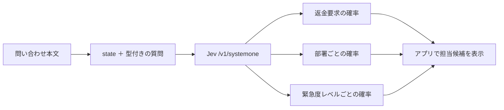

# TypeSafe AI の Jev API を使用して型付き判断を行う

TypeSafe AI の判断モデル **Jev** に日本語の問い合わせを送り、返金の要否、担当部署、緊急度を 1 リクエストで判定する。分類や採点の結果を確率つきで受け取り、振り分けやレビューの条件をアプリケーション側に書ける。

## 📑 目次

- [アーキテクチャ](#-アーキテクチャ)
- [Jev を採用するメリット・デメリット](#-jev-を採用するメリットデメリット)
- [クラウドでの Jev 対応と代替機能](#-クラウドでの-jev-対応と代替機能)
    - [TypeSafe の Jev 本体を呼び出す](#typesafe-の-jev-本体を呼び出す)
    - [各社の判断専用 API・モデルを使う](#各社の判断専用-apiモデルを使う)
- [使用方法](#-使用方法)
- [実行結果](#-実行結果)
    - [応答の読み方](#応答の読み方)
    - [日本語の問い合わせでの動作比較](#日本語の問い合わせでの動作比較)
- [開発者向け情報](#-開発者向け情報)
- [注意点・課題](#-注意点課題)
- [参考サイト](#-参考サイト)

## 🏗️ アーキテクチャ



**Typed Decision Model（TDM）** は、入力の状態と質問に対して、あらかじめ定義した形式で判断を返すモデル。TypeSafe は Jev を **System One** モデルと呼んでいる。たとえば、生成 LLM の構造化出力で部署名を受け取る設計に対し、Jev の `choice` は指定した全候補の確率を返すため、次点との差や採用しなかった候補もアプリで確認できる。

| 型 | 用途 | 主な応答フィールド |
| --- | --- | --- |
| `noul` | はい／いいえの判定 | `noul`（「はい」の確率） |
| `choice` | 順序のない候補から 1 つ選択 | `choice`、`probabilities`、`confidence` |
| `score` | 順序付きの評価基準で採点 | `score`、`probabilities`、`confidence` |
| `box` | 画像内の位置を指定 | `box`（画像サイズで正規化した上下左右の座標）、`confidence`。Jev 1.14 が対応 |

同じリクエストの各質問は共通の `state` を参照する。前の回答を使って次の質問を組み立てる処理は、アプリ側で別のリクエストとして行う。TypeSafe は質問を並列処理するサンプラーと、確率の校正を目的とした強化学習手法（RLCD）を公表している。実際に使う入力で確率と正解率の関係を確認する方法は [評価の Tip](../79/) を参照。

## ⚖️ Jev を採用するメリット・デメリット

| 比較軸 | メリット | デメリット |
| --- | --- | --- |
| 結果の取り扱い | 候補全体の確率や段階ごとの分布を受け取れる。生成 LLM の構造化出力でラベルだけを返す場合より、次点との差を使ったレビュー振り分けを実装しやすい | 候補や評価基準を先に定義する必要がある。確率の偏りや誤判定は残るため、実データでしきい値を調整する |
| 速度と費用 | 短い判断で生成 LLM の呼び出しを置き換えられる。共通の入力に対する独立した質問は 1 リクエストにまとめられる | 既存フローに追加すると通信や再判定が増える。ルールだけで確定できる判断にモデルを加えると、処理が増える |
| 判断できる範囲 | 分類、候補の順位付け、基準が明確な採点に使える | 自由記述の回答や判断理由の生成には別の LLM が必要。複数段の推論や厳密な計算は、ルールや別の処理と組み合わせる |
| 運用 | ホスト型の API なので自前でモデルを配備する工程を省ける | 外部通信と API 認証が必要。モデル版や候補を変更したときはしきい値を再評価する |

## ☁️ クラウドでの Jev 対応と代替機能

2026 年 11 月 27 日時点の公開資料に基づく。モデル名、呼び出し先、入力データを処理する事業者を確認して選ぶ。

### TypeSafe の Jev 本体を呼び出す

| 提供経路 | 対応状況 | 公式資料 |
| --- | --- | --- |
| TypeSafe API | `POST /v1/systemone` で直接呼び出せる | [TypeSafe のモデル一覧](https://docs.typesafe.ai/models) |
| AWS・GCP・Azure の Databricks | Unity Gateway 経由で Jev 1.14.0 を利用できる。管理者がアカウントのプレビューを有効にする必要があり、モデルは TypeSafe がホストする | [AWS 版](https://docs.databricks.com/aws/en/machine-learning/foundation-model-apis/supported-models) / [GCP 版](https://docs.databricks.com/gcp/en/machine-learning/foundation-model-apis/supported-models) / [Azure 版](https://learn.microsoft.com/en-us/azure/databricks/machine-learning/foundation-model-apis/supported-models#typesafe-ai-jev-1140) |
| AWS Bedrock AgentCore Evaluations | Lambda のカスタム評価器から TypeSafe API を呼ぶ公式例がある。Bedrock の公開基盤モデル一覧では Jev 本体の掲載を確認できなかった | [AgentCore の公式例](https://aws.amazon.com/blogs/machine-learning/use-decision-models-with-amazon-bedrock-agentcore-evaluations/) / [Bedrock モデル一覧](https://docs.aws.amazon.com/bedrock/latest/userguide/model-cards.html) |
| Google Cloud Model Garden・Microsoft Foundry | 両サービスの公開資料では Jev 本体のネイティブ提供を確認できなかった。上記の Databricks 経由、または TypeSafe API への直接接続が選べる | [Model Garden](https://docs.cloud.google.com/gemini-enterprise-agent-platform/models/model-garden/use-models) / [Foundry モデルカタログ](https://ai.azure.com/catalog) |
| Vercel AI Gateway・OpenRouter・Cloudflare | 各社のゲートウェイや推論 API に Jev が掲載されている。利用できるモデル版と質問型は経路ごとに確認する | [Vercel](https://vercel.com/kb/jev-from-typesafe-ai) / [OpenRouter](https://openrouter.ai/blog/insights/what-is-jev/) / [Cloudflare](https://developers.cloudflare.com/ai/models/typesafe/jev/) |

### 各社の判断専用 API・モデルを使う

| サービス | 提供機能 | 利用時の違い | 公式資料 |
| --- | --- | --- | --- |
| Gemini API / Google AI Studio | **Gemini Decisions API**（`gemini-decision-1`）。`noul`、`choice`、`score` を提供し、テキスト・画像・音声・動画・PDF を入力できる | Google は AI Studio からの利用を案内。Google Cloud 向けは公式発表で提供予定とされている | [Google の発表](https://blog.google/innovation-and-ai/technology/developers-tools/gemini-decisions-api/) |
| OpenAI API | **Decisions API**（`gpt-6-luna`、`POST /v1/decisions`）は一般提供。テキスト・画像・JSON を入力できる | 二値判定の質問型は `predicate`。リクエストは `input` と `questions` を使う | [OpenAI の Decisions ガイド](https://developers.openai.com/api/docs/guides/decisions) |
| Azure OpenAI | **Decisions API**（`gpt-6-luna`、`/openai/v1/decisions`） | 対応リージョンに順次展開。リクエストの `model` にはデプロイ名を指定する | [Azure OpenAI の Decisions ガイド](https://learn.microsoft.com/en-us/azure/foundry/openai/how-to/decisions) |
| Microsoft Foundry | **Microsoft-Decision-1.1** は一般提供。テキスト・JSON・画像を入力し、`noul`、`choice`、`score` を利用できる | Foundry にデプロイして呼び出す Microsoft の判断専用モデル | [Foundry の発表](https://devblogs.microsoft.com/foundry/whats-new-in-microsoft-foundry-ignite-2026/) / [利用ガイド](https://learn.microsoft.com/en-us/azure/foundry/foundry-models/how-to/use-foundry-models-microsoft-decision) |
| AWS | **Strands Decider** は公開モデルで、SageMaker AI に自分で配備できる | Bedrock でも GPT-6 Luna は利用可能。AWS のモデルカードでは OpenAI の `/v1/decisions` の対応は確認できない | [Strands の SageMaker ガイド](https://strandsagents.com/docs/user-guide/sdk/decision-models/models/sagemaker/) / [Bedrock の GPT-6 Luna モデルカード](https://docs.aws.amazon.com/bedrock/latest/userguide/model-card-openai-gpt-6-luna.html) |

Google Cloud の OpenAI パートナーモデルでは、GPT-6 Luna はプライベートプレビューの Responses API で利用できる。Google Cloud の機能表では Decisions API は対象外。[Google Cloud の OpenAI モデル一覧](https://docs.cloud.google.com/gemini-enterprise-agent-platform/models/partner-models/openai)

同じ問い合わせを別の API で判定するコードは、[Gemini Decisions API](../80/)、[OpenAI Decisions API](../81/)、[AWS 上の Databricks 経由で Jev を呼ぶ方法](../82/) を参照。

ラベルやスコアを JSON で受け取る用途なら、Google Cloud の Gemini、Amazon Bedrock、Anthropic Claude の構造化出力も使える。JSON Schema が制約するのは出力形式で、確率の校正は別途評価が必要。モデルや API を切り替える場合は、質問型と応答フィールドを確認し、同じ評価データでしきい値を決め直す。[Google Cloud](https://docs.cloud.google.com/gemini-enterprise-agent-platform/models/capabilities/control-generated-output) / [Amazon Bedrock](https://docs.aws.amazon.com/bedrock/latest/userguide/structured-output.html) / [Anthropic](https://platform.claude.com/docs/en/build-with-claude/structured-outputs)

## 🚀 使用方法

1. GNU Make、uv、Python 3.11 以降を用意する。リポジトリのルートで次を実行する。

    ```bash
    cd nlp_processing/77
    make setup
    make install
    ```

1. [TypeSafe の Quick start](https://docs.typesafe.ai/introduction/quickstart) に沿ってキーを取得し、`.env` の `TYPESAFE_API_KEY` に設定する。

1. 問い合わせを判定する。`MESSAGE` を省略すると架空の返金依頼を使う。

    ```bash
    make run
    make run MESSAGE='登録したメールアドレスを変更したいです。'
    ```

1. 出力 JSON の `answers` から質問 ID ごとの値を確認する。`model` は応答したモデル ID、`usage` は使用トークンを示す。HTTP エラーやタイムアウト時は、呼び出し元で担当者レビューなど既存の振り分けに戻す。

## 📊 実行結果

### 応答の読み方

| 確認するフィールド | 解釈 |
| --- | --- |
| `answers.refund_requested.noul` | 1 に近いほど返金要求ありと判断している。0.5 付近は「はい」「いいえ」が拮抗している |
| `answers.department.choice` | この例で期待する部署 ID は `billing`。曖昧な問い合わせは `probabilities` で次点も確認する |
| `answers.urgency.score` | レベル番号 0、1、2 の期待値。仮に確率が 0.70、0.25、0.05 ならスコアは 0.35。レベル 2 を拾いたいときは `probabilities["2"]` を直接使う |

Jev の `choice` の `confidence` は、候補数と最大確率から計算される。候補が 3 件で最大確率が 0.6 なら `confidence` は 0.4。候補数を固定した場合、最大確率と `confidence` を両方しきい値にかけても、同じ情報を見ていることになる。表の値と計算例は応答形式を読むための例。

ローカルの模擬 API で `make run` の認証ヘッダーと 3 種類の質問を確認した。正常応答では JSON を出力し、HTTP 429、不正な JSON、API キー未設定時はエラー終了した。実 API はキー未設定のため未計測。

### 日本語の問い合わせでの動作比較

同じ架空の問い合わせ 4 件を、キーワードルール、生成 LLM（Ollama の `qwen3:1.7b`）、Jev と同じ型付き判断を行う [saihai-v1-310m](../78/) で振り分けた。Qwen には部署 ID を JSON Schema の列挙型で指定し、thinking をオフ、temperature を 0 にした。saihai は CPU で実行した。

| 問い合わせ | 正解 | キーワードルール | Qwen の構造化出力 | saihai の Choice |
| --- | --- | --- | --- | --- |
| 有料プランを解約したはずですが、今月も請求されました。返金を希望します。 | `billing` | `billing` | `billing` | `billing` |
| データの書き出しを押すと、毎回画面が真っ白になります。 | `technical` | 保留 | `technical` | `technical` |
| 登録したメールアドレスを別のものに変更したいです。 | `account` | `account` | `account` | `account` |
| 同じ注文なのに、カードの明細に同じ金額が二度載っています。 | `billing` | 保留 | `technical` | `billing` |
| **正解件数（保留は正解に含めない）** | **4 件** | **2 / 4** | **3 / 4** | **4 / 4** |

ルールは「請求・支払い・返金」「障害・不具合・エラー」「登録・ログイン」の部分一致を使い、該当部署が 1 つに定まらなければ保留する。Qwen と saihai には上の API 例と同じ 3 部署の説明を渡した。いずれも 4 件の動作確認で、Jev API はキー未設定のため、この入力セットでは未計測。Jev 本体と従来方式を同じタスクで比較した結果は [公表テストの比較表](../79/#-実行結果) を参照。

## 🛠️ 開発者向け情報

- [`run.py`](run.py) が実行エントリーポイント。`make run` の出力は JSON。
- [`Makefile`](Makefile) で `make setup`、`make install`、`make run` を管理する。`make setup` は既存の `.env` を保持する。
- [`pyproject.toml`](pyproject.toml) と [`uv.lock`](uv.lock) で Python 環境を管理する。設定項目は [`.env.example`](.env.example) を参照。

## ⚠️ 注意点・課題

- `choice` はどの候補にも当てはまらない入力でも候補を 1 つ選ぶ。対象外の問い合わせが多い場合は、候補に当てはまるかを `noul` で別に確認する。
- 件数の集計や日付の比較はコードで処理し、モデルには短い文脈で答えられる質問を渡す。長い履歴や無関係な項目を加えると判断がぶれる場合がある。
- TypeSafe のモデル一覧では、Jev 1.14 の通常の上限はリクエスト全体で 64k、各質問で 32k トークン。入力 100 万トークンあたり 0.042 米ドルで、出力は無料（2026 年 11 月の公開仕様）。判断を追加するとリクエストが増える場合があるため、遅延と費用は処理全体で比べる。
- 上記のリクエストは問い合わせ本文を TypeSafe API へ送る。ローカルの日本語モデルで試す手順は [saihai の Tip](../78/) を参照。

## 🔗 参考サイト

- [TypeSafe AI の Quick start](https://docs.typesafe.ai/introduction/quickstart)
- [TypeSafe AI の質問型一覧](https://docs.typesafe.ai/primitives)
- [TypeSafe AI の Confidence](https://docs.typesafe.ai/confidence)
- [TypeSafe AI のモデル一覧](https://docs.typesafe.ai/models)
- [TypeSafe AI の Model jaggedness](https://docs.typesafe.ai/model-jaggedness)
- [TypeSafe AI の Jev 発表記事](https://typesafe.ai/blog/introducing-system-one-models-and-jev)
- [Ollama の Structured Outputs](https://docs.ollama.com/capabilities/structured-outputs)
