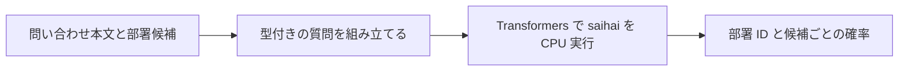

# 日本語対応の Jev モデル（saihai）をローカルで動かして、型付き判断を行う

**saihai-v1-310m** は、TypeSafe の Jev と同様に型付き判断を返す、日本語対応の公開モデル。ここでは Transformers で読み込み、CPU 上で問い合わせの担当部署を選ぶ。モデルを事前に取得しておけば、問い合わせ本文を外部 API に送らずに判断できる。対応する型や応答フィールドは実装ごとに確認する。

## 📑 目次

- [アーキテクチャ](#-アーキテクチャ)
- [比較対象のモデル](#-比較対象のモデル)
- [使用方法](#-使用方法)
- [実行結果](#-実行結果)
    - [CPU での動作確認](#cpu-での動作確認)
    - [日本語ベンチマークの見方](#日本語ベンチマークの見方)
- [開発者向け情報](#-開発者向け情報)
- [注意点・課題](#-注意点課題)
- [参考サイト](#-参考サイト)

## 🏗️ アーキテクチャ



初回は Hugging Face からモデルを取得する。以降はローカルのキャッシュから読み込み、推論も同じ環境で行う。

## 🧩 比較対象のモデル

| モデル | 構成・ベース | 公開ライセンス・提供形態 | 試すときのポイント |
| --- | --- | --- | --- |
| TypeSafe Jev | TypeSafe の System One モデル。詳細なモデル構成は非公開 | ホスト型 API | [Jev API の Tip](../77/) の手順で試す |
| saihai-v1-310m | ruri-v3-reranker-310m を調整したエンコーダ。入力の共通部分を候補間で再利用 | Apache-2.0 | CPU で動作。モデルカードの `systemone()` は `choice` の確率を返す |
| saihai-v1-8b | llm-jp をベースにしたデコーダ。候補のロジットを読み出す | Apache-2.0 | GGUF 版は対応する llama.cpp ビルドの `/v1/systemone` で提供できる |
| Kev | Qwen ベースの判断モデル群 | Apache-2.0 | Jev 互換サーバーがある。モデルサイズ、対応型、候補の上限を確認する |
| Laya Multilingual | mmBERT ベースのエンコーダ | Apache-2.0 | 多言語入力に対応。日本語での適合性は対象タスクで測る |
| AutoTrust Decider Pro Vision 27B（旧 JEV-27B-VL） | Qwen ベースの画像・テキスト向けモデル | Apache-2.0 | 配備時にモデルカードのランタイム制約を確認する |
| GEV-26B-Decide | Gemma 4 ベース。判断用ヘッドと生成モードを提供 | カード表示は Apache-2.0。ベースの条件も確認 | 生成モードを併用する場合は、切り替えに伴う遅延も測る |
| StartLux-Decision v1.1 27B Instant | Qwen ベースの即時判断モデル | CC BY-NC 4.0（重み） | 商用利用の候補からは外し、利用条件を確認する |

公開モデルのインターフェースが Jev に似ていても、モデルの系列、学習データ、候補確率の分布、ライセンスは別々に確認する。重みやベースモデルに加え、使用するコードと評価データの利用条件も見る。

## 🚀 使用方法

1. GNU Make、uv、Python 3.12 を用意する。モデルと Python 依存をダウンロードできる環境で次を実行する。uv は CPU 版 PyTorch を同期する。

    ```bash
    cd nlp_processing/78
    make setup
    make install
    ```

1. サンプルを実行する。初回は Hugging Face からモデルとカスタムローダーを取得する。実行するコードは [公開リビジョン](https://huggingface.co/hotchpotch/saihai-v1-310m/tree/704809fa038ff647b1a0e9cda963f1b8a06e0c95) に固定している。キャッシュの場所を指定する場合は `.env` の `HF_HOME` を設定する。

    ```bash
    make run
    make run MESSAGE='登録したメールアドレスを変更したいです。'
    ```

1. `answers.department.choice` と候補ごとの `probabilities` を確認する。モデル取得後は `.env` の `HF_HUB_OFFLINE` を `1` にして同じ手順で再実行できる。閉域環境に配る場合は、モデルと Python 依存を接続可能な環境で事前に取得する。

## 📊 実行結果

### CPU での動作確認

モデルがキャッシュにある環境で `HF_HUB_OFFLINE=1` を設定し、`make run` を CPU で実行した。

| 入力 | 選択された部署 |
| --- | --- |
| 既定の返金依頼 | `billing` |
| 登録メールアドレスの変更 | `account` |

どちらも 3 候補の確率が返り、合計が 1 になることを確認した。

### 日本語ベンチマークの見方

[S1MB の日本語版](https://huggingface.co/spaces/hotchpotch/S1MB-leaderboard?category=japanese-v1) は 27 ベンチマーク・8,067 判断を集約する。`Task Avg` は Noul・Choice・Score の基準値調整済みスコアを型ごとに平均し、その 3 値を等重みで集約する。下表は [ベンチマーク作者の公開記事](https://secon.dev/entry/2026/10/15/100000-saihai-japanese-decision-benchmark/) の掲載値。

| モデル | S1MB Japanese v1 の Task Avg |
| --- | ---: |
| Jev 1.13 | 56.33 |
| saihai-v1-8b | 49.77 |
| saihai-v1-310m | 30.19 |
| laya-multilingual | 5.29 |

- 総合スコアに加え、実際に使う型の内訳を確認する。評価入力はアクセス制限付きで、公開リーダーボードは手元での再計測と区別する。
- saihai の学習には一部の評価データと由来が同じタスクの訓練用データが含まれる。本番で扱う文体や業務に対する汎化は、別途用意した日本語データで測る。
- GGUF の量子化比較は、GGUF モデルカード内の同一条件の表を使う。モデルカードでは Q8_0 と Q4_K_M のファイルサイズはそれぞれ 9.13 GB と 5.30 GB。実行時のメモリには推論バッファや KV キャッシュも含まれる。

## 🛠️ 開発者向け情報

- [`run.py`](run.py) が実行エントリーポイント。`make run` の出力は JSON。
- [`Makefile`](Makefile) で `make setup`、`make install`、`make run` を管理する。`make setup` は既存の `.env` を保持する。
- [`pyproject.toml`](pyproject.toml) と [`uv.lock`](uv.lock) で Python 環境を管理する。設定項目は [`.env.example`](.env.example) を参照。

## ⚠️ 注意点・課題

- `saihai-v1-310m` の Transformers ラッパーは `choice` の `confidence` を返さない。クラウド版と併用する場合は双方が返す `probabilities` を使い、最大確率や次点との差のしきい値をモデルごとに選ぶ。モデルや量子化を変更したときも再評価する。
- テキスト対応モデルから画像対応モデルに切り替える場合は、入力形式、座標の定義、対応する質問型も確認する。Computer Use の候補選択を調べる場合は、候補の正答率に加えて、画面変更を含むタスク全体の成功率を測る。

## 🔗 参考サイト

- [saihai-v1-310m モデルカード](https://huggingface.co/hotchpotch/saihai-v1-310m)
- [saihai-v1-8b モデルカード](https://huggingface.co/hotchpotch/saihai-v1-8b)
- [saihai-v1-8b GGUF モデルカード](https://huggingface.co/hotchpotch/saihai-v1-8b-gguf)
- [S1MB の評価仕様](https://github.com/hotchpotch/S1MB)
- [S1MB 作者による日本語ベンチマークの紹介](https://secon.dev/entry/2026/10/15/100000-saihai-japanese-decision-benchmark/)
- [Kev](https://github.com/jaredpalmer/kev)
- [Laya Multilingual](https://huggingface.co/convaiinnovations/laya-multilingual)
- [AutoTrust Decider Pro Vision 27B](https://huggingface.co/autotrust/AutoTrust-Decider-Pro-Vision-27B)
- [GEV-26B-Decide](https://huggingface.co/autotrust/GEV-26B-Decide)
- [StartLux-Decision v1.1 27B Instant](https://huggingface.co/startlux-models/StartLux-Decision-v1.1-27B-Instant)
