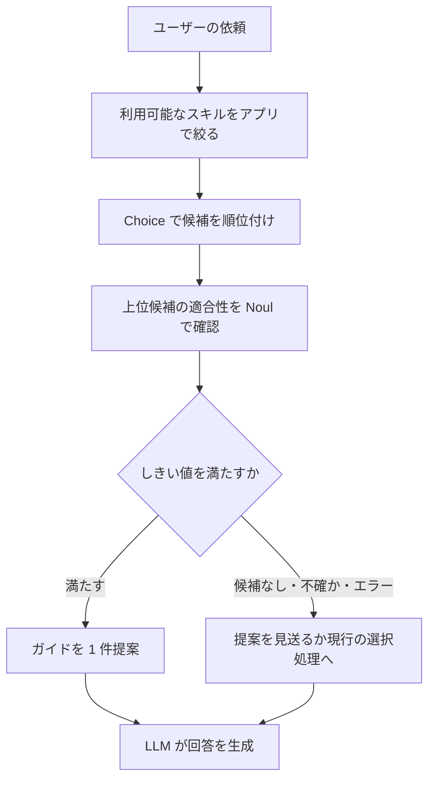

# Jev を AI エージェントのスキル選択に組み込み、日本語データで評価する

スキル選択を、回答生成とは独立した判断として取り出す。例題では質問に応じて「請求明細の読み方」「障害調査の手順」「利用状況レポートの作成」のガイドを候補にし、該当ガイドがあるときだけエージェントに提案する。ここでは実装する判断フローと、日本語データで現行方式と比べる手順を扱う。API の呼び出し方は [Jev API の Tip](../77/)、ローカル実行は [saihai の Tip](../78/) を参照。

## 📑 目次

- [アーキテクチャ](#-アーキテクチャ)
- [適用範囲](#-適用範囲)
- [使用方法](#-使用方法)
    - [サンプルを実行する](#サンプルを実行する)
    - [スキル選択を実装する](#スキル選択を実装する)
    - [日本語データで評価する](#日本語データで評価する)
- [実行結果](#-実行結果)
    - [スキル選択](#スキル選択)
    - [エージェントの進行・完了判定](#エージェントの進行完了判定)
- [開発者向け情報](#-開発者向け情報)
- [参考サイト](#-参考サイト)

## 🏗️ アーキテクチャ



## 🧭 適用範囲

| 判断点 | 判断結果の使い方 |
| --- | --- |
| スキル選択、問い合わせ振り分け | 上位候補の提案。該当なしや曖昧な依頼では見送り |
| RAG の関連性 | 検索で取得した候補の選別。最終回答に必要な根拠を保持できるか確認 |
| 入出力ガード | レビュー対象の一次選別。`allow` や `block` はアプリのルールと承認経路で決定 |
| ツール実行や外部送信 | 権限確認と承認はアプリが担当。モデルは候補やレビュー理由の信号を提供 |
| 回答の生成 | LLM が担当。判断モデルはスキルの適合性や根拠の有無など個別の質問を担当 |

## 🚀 使用方法

### サンプルを実行する

1. GNU Make、uv、Python 3.11 以降を用意する。リポジトリのルートで次を実行する。

    ```bash
    cd nlp_processing/79
    make setup
    make install
    ```

1. `.env` の `TYPESAFE_API_KEY` に TypeSafe API キーを設定する。`JEV_MIN_FIT` は提案に必要な適合確率、`JEV_MIN_GAP` は上位 2 件の差。既定値はそれぞれ `0.70` と `0.15`。

1. 1 件の依頼を判定するか、サンプル 4 件を評価する。

    ```bash
    make run
    make run MESSAGE='レポート作成画面が開かない'
    make evaluate
    ```

    `choice_only` は順位付けだけの候補、`recommended` は再判定後の提案、`fit` は上位候補ごとの適合確率。見送り時は `recommended` が `null`。通信や応答形式の異常時はエラー終了するので、呼び出し元でフォールバックを実装できる。

### スキル選択を実装する

1. アプリでこのユーザーが参照できるスキルを取り出す。ID、短い説明、使う条件を用意する。例では `billing_guide` を請求明細の確認、`troubleshooting_guide` を画面や機能の不具合、`usage_report_guide` を利用状況の集計・出力に使う。候補が 0 件なら提案を見送り、1 件なら順位付けを省いて適合性確認に進む。候補上限を超えるカタログは、既存の検索やカテゴリで先に絞る。
1. 依頼文と候補を `choice` に渡す。`criteria` は固定 ID と説明のマップにする。`answers.<質問ID>.probabilities` から上位 3 件までを抽出する。たとえば「先月の請求書の内訳を確認したい」は、ID が `billing_guide` のガイドを期待する。
1. 別のリクエストで上位候補を確認する。候補の詳しい説明と依頼文を `state` に含め、候補ごとに「このガイドの使用条件を満たし、依頼への回答に役立つか」を `noul` で問う。合格した候補のうち `noul` が最大の 1 件を提案する。上位 2 件が拮抗する場合や、合格候補がない場合は見送る。第 1 段の `choice` は候補内の順位に使い、第 2 段で該当なしを扱う。
1. 提案した ID が利用可能なカタログに属するかを検証する。HTTP エラー、タイムアウト、応答形式の不一致は「該当なし」と区別して記録し、現行の選択処理に戻す。操作の権限と承認はアプリ側で検証する。

| 依頼の例 | 正解ラベルの例 | 確認したい分岐 |
| --- | --- | --- |
| 先月の請求書の内訳を確認したい | `billing_guide` | 近い候補を提示できる |
| レポート作成画面が開かない | `troubleshooting_guide` | 単語の一致と依頼の目的を区別できる |
| こんにちは。今日は何曜日？ | 該当なし | `choice` の先頭候補をそのまま採用しない |
| 請求の話もあります。何を相談するかまだ決めていません | 要確認 | 曖昧な入力を自動採用から外せる |

### 日本語データで評価する

1. 対象スキルごとに短文、表記揺れ、似た候補との境界例を含める。該当なしや要確認も正解として付ける。元の依頼とその言い換えが別セットにまたがらないよう、依頼単位でしきい値調整用と最終評価用に分ける。
1. 現行の選択処理、Jev の `choice` のみ、`choice` と `noul` の 2 段方式を同じ依頼・カタログで比べる。前段に検索を使うなら正解候補が上位 3 件に残る割合も測る。第 2 段では前段で落とした候補を拾えない。
1. 調整セットで第 2 段の `noul` の下限と上位 2 件の差の下限を動かし、提案率と誤提案率のバランスを見る。最終評価ではしきい値を固定する。同じ内容の言い換えや候補順の変更でも判断が安定するか確認する。
1. 最終セットで下表の指標を出す。既存の選択処理を置き換える構成と、既存の処理に判断を追加する構成では、エージェント全体の呼び出し回数が異なる。提案の選択精度に加え、最終回答のタスク成功率と費用を比較する。

| 指標 | 算出方法 |
| --- | --- |
| 提案率 | 提案した件数 ÷ 全件数 |
| 誤提案率 | 提案のうち正解以外を選んだ件数 ÷ 提案件数 |
| 不要提案率 | 該当なしの依頼で提案した件数 ÷ 該当なし件数 |
| 選択再現率 | 正解スキルを提案した件数 ÷ 正解スキルがある件数 |
| フォールバック率 | 現行処理に回した件数 ÷ 全件数。通信エラーは別途集計する |
| レイテンシ・費用 | 選択と回答生成それぞれの p50／p95 と、1,000 件あたりの費用。フォールバックも含める |

確率をしきい値に使う場合は、たとえば `noul` が 0.8〜0.9 の依頼について、人が実際に「適合」と判定した割合と件数を確認する。モデル ID、質問文、カタログ版、候補数、しきい値を固定して記録する。しきい値やモデル更新の比較を行うときは、それぞれ同じ評価入力で計測する。

## 📊 実行結果

模擬 API で、候補の採用、低確率または候補間の差が小さい場合の見送り、API エラー時の終了を確認した。`make evaluate` で 4 件を集計できることも確認した。実 API はキー未設定のため、日本語の例題でのモデル精度は未計測。以下は Jev と従来方式を比較した公表結果。

### スキル選択

TypeSafe は Hermes の 194 スキルと 452 件の依頼で比較した。Jev を加えた構成では、上位 3 候補の再判定結果を同じ Claude Haiku 4.5 に提示している。以下は [TypeSafe のクックブック](https://docs.typesafe.ai/cookbooks/skill_suggestion) の公表値。

| スキル選択の構成 | 間違ったスキルを読み込んだ割合（候補あり 280 件） | 不要なスキルを読み込んだ割合（候補なし 172 件） |
| --- | ---: | ---: |
| Claude Haiku 4.5 単独 | 15.7% | 14.0% |
| Claude Haiku 4.5 ＋ Jev 1.14 の候補提案 | 7.9% | 5.2% |

### エージェントの進行・完了判定

Terminal-Bench 2.1 では、Claude Sonnet 5.5 を使うエージェントを固定し、制御方式を変えて 21 タスクで比較した（各方式 63 試行）。以下は [研究論文の表 1](https://arxiv.org/html/2610.24649v1#S4) の公表値。

| 追加の制御方式 | タスク成功率 | 1 試行あたり平均費用 | 1 試行あたり平均実行時間 |
| --- | ---: | ---: | ---: |
| 追加制御なし | 73.0% | 0.177 USD | 9.4 分 |
| 決定論ルール | 73.0% | 0.191 USD | 9.5 分 |
| 小型 LLM（Claude Haiku 5.5） | 76.2% | 0.213 USD | 10.9 分 |
| Jev 1.13 | 73.0% | 0.206 USD | 10.1 分 |

研究のタスク単位の費用比（表 2 の幾何平均）では、Jev は追加制御なしに対して 1.19 倍、小型 LLM に対して 0.81 倍だった。成功率の差は検出されなかった。スキル選択と進行・完了判定では目的も指標も異なるため、日本語の対象業務では[使用方法](#-使用方法)の手順で評価する。

## 🛠️ 開発者向け情報

- [`run.py`](run.py) が実行エントリーポイント。`make run` の出力は JSON。
- [`Makefile`](Makefile) で `make setup`、`make install`、`make run` を管理する。`make setup` は既存の `.env` を保持する。
- `make evaluate` はサンプル 4 件の判定を JSON で出力する。
- [`pyproject.toml`](pyproject.toml) と [`uv.lock`](uv.lock) で Python 環境を管理する。設定項目は [`.env.example`](.env.example) を参照。

## 🔗 参考サイト

- [TypeSafe AI の Skill suggestion クックブック](https://docs.typesafe.ai/cookbooks/skill_suggestion)
- [TypeSafe AI の Companion Noul パターン](https://docs.typesafe.ai/patterns/companion-noul)
- [TypeSafe AI の Confidence 解説](https://docs.typesafe.ai/confidence)
- [Good Judgment, Bad Advice: Decision-Model Controllers Raise Agent Cost Without Improving Success](https://arxiv.org/abs/2610.24649)
