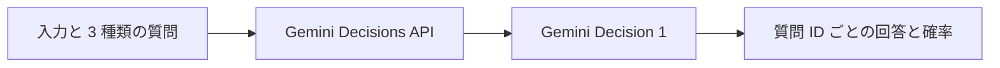

# Google の Gemini Decisions API を使用して分類・選択・採点を行う

Google の判断専用モデル **Gemini Decision 1** に、入力と選択肢・評価基準を渡す。ここでは [Jev API の Tip](../77/) と同じ日本語の問い合わせを使い、返金要求の有無、担当部署、緊急度をまとめて判定する。

## 📑 目次

- [アーキテクチャ](#-アーキテクチャ)
- [Jev API との主な違い](#-jev-api-との主な違い)
- [使用方法](#-使用方法)
- [実行結果](#-実行結果)
- [開発者向け情報](#-開発者向け情報)
- [参考サイト](#-参考サイト)

## 🏗️ アーキテクチャ



## 🧩 Jev API との主な違い

| 比較軸 | Gemini Decisions API | TypeSafe Jev 1.14 |
| --- | --- | --- |
| API | `POST /v1beta/decisions` | `POST /v1/systemone` |
| 入力フィールド | `input` | `state` |
| 質問型 | `noul`、`choice`、`score` | `noul`、`choice`、`score`、`box` |
| 対応するメディア | テキスト、画像、音声、動画、PDF | テキスト、画像 |
| 利用経路 | Gemini Developer API（Google AI Studio の API キー） | TypeSafe API |

Google は Gemini Developer API での利用を案内している。Google Cloud の提供状況は公式発表を参照。

## 🚀 使用方法

1. GNU Make、uv、Python 3.11 以降を使える環境で、リポジトリのルートから Tip のディレクトリに移動する。

    ```bash
    cd nlp_processing/80
    make setup
    make install
    ```

1. [Google AI Studio](https://aistudio.google.com/apikey) で発行したキーを `.env` の `GEMINI_API_KEY` に設定する。

1. サンプルを実行する。入力を変える場合は `MESSAGE` を指定する。

    ```bash
    make run
    make run MESSAGE='登録したメールアドレスを変更したいです。'
    ```

## 📊 実行結果

`make run` は API の応答を JSON で標準出力に表示する。次のフィールドを使って判断を確認する。

| 質問 | 確認するフィールド |
| --- | --- |
| 返金を依頼しているか | `answers.refund_requested.noul`（「はい」の確率） |
| どの部署が担当か | `answers.department.choice` と `probabilities`。サンプルで期待する部署は `billing` |
| 緊急度はどの程度か | `answers.urgency.score` と `probabilities`。レベル 0〜2 の順序はリクエストで定義する |

設定済みの `.env` を使い、`make run` で Gemini の実 API に架空の問い合わせを 2 件送った。どちらも 3 種類の回答が返り、担当部署が期待値と一致した。表は出力値を丸めた実測例。

| 入力 | 返金要求の確率 | 部署 | 選択された部署の確率 | 緊急度（0〜2） |
| --- | ---: | --- | ---: | ---: |
| 既定の返金依頼 | 0.990 | `billing` | 0.981 | 0.732 |
| 登録メールアドレスの変更 | 0.033 | `account` | 0.999 | 0.134 |

模擬 API では認証情報の未設定、HTTP 429、JSON 以外の応答でエラー終了することを確認した。

## 🛠️ 開発者向け情報

- [`Makefile`](Makefile) は `setup`、`install`、`run` を管理する。`make setup` は既存の `.env` を保持する。
- [`pyproject.toml`](pyproject.toml) と [`uv.lock`](uv.lock) で Python 環境を管理する。外部 Python パッケージは不要。
- [`run.py`](run.py) は `x-goog-api-key` ヘッダーで REST API を呼ぶ。サンプルのキー設定は [`.env.example`](.env.example) を参照。

## 🔗 参考サイト

- [Gemini Decisions API の公式発表](https://blog.google/innovation-and-ai/technology/developers-tools/gemini-decisions-api/)
- [Google Codelabs の Gemini Decisions API 入門](https://codelabs.developers.google.com/getting-started-with-gemini-decisions-api)
- [Google Codelabs の Jev と Gemini Decisions の比較](https://codelabs.developers.google.com/codelabs/discriminative-models)
