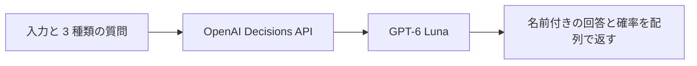

# OpenAI の Decisions API を使用して分類・選択・採点を行う

OpenAI の **Decisions API** と **GPT-6 Luna** を使い、複数の質問に対する回答と確率を取得する。[Jev API の Tip](../77/) と同じ日本語の問い合わせを使い、返金要求の有無、担当部署、緊急度を判定する。

## 📑 目次

- [アーキテクチャ](#-アーキテクチャ)
- [Jev API との主な違い](#-jev-api-との主な違い)
- [使用方法](#-使用方法)
- [実行結果](#-実行結果)
- [開発者向け情報](#-開発者向け情報)
- [参考サイト](#-参考サイト)

## 🏗️ アーキテクチャ



## 🧩 Jev API との主な違い

| 比較軸 | OpenAI Decisions API | TypeSafe Jev 1.14 |
| --- | --- | --- |
| API | `POST /v1/decisions` | `POST /v1/systemone` |
| 入力フィールド | `input` | `state` |
| 質問型 | `predicate`、`choice`、`score` | `noul`、`choice`、`score`、`box` |
| 質問と回答の紐づけ | `questions` と `answers` は配列。要素の `name` で対応付ける | 質問と回答は質問 ID をキーにしたオブジェクト |
| 候補・評価基準の指定 | `choices` に値と説明、`levels` にラベルと説明を指定 | `criteria` に候補マップまたは段階の配列を指定 |

テキスト、画像、JSON を判断対象にできる。根拠を文章で出す、任意の JSON Schema で抽出するなどの用途は Responses API が担当する。

## 🚀 使用方法

1. GNU Make、uv、Python 3.11 以降を使える環境で、リポジトリのルートから Tip のディレクトリに移動する。

    ```bash
    cd nlp_processing/81
    make setup
    make install
    ```

1. [OpenAI API キー設定](https://platform.openai.com/api-keys) で取得したキーを `.env` の `OPENAI_API_KEY` に設定する。

1. サンプルを実行する。入力を変える場合は `MESSAGE` を指定する。

    ```bash
    make run
    make run MESSAGE='登録したメールアドレスを変更したいです。'
    ```

## 📊 実行結果

`make run` は API の応答を JSON で標準出力に表示する。`answers` の各要素は `name` で取り出す。

| `name` | 確認するフィールド |
| --- | --- |
| `refund_requested` | `probability`（「はい」の確率） |
| `department` | `choice` と `probabilities`。サンプルで期待する部署は `billing` |
| `urgency` | `score` と `probabilities`。スコアは定義したレベル番号の加重平均 |

各回答の `type` を確認してから値を使う。応答が `refusal` の場合は、判定を適用せずレビューなどへ回す。

模擬 API で、`make run` が `.env` を読み込み、3 種類の質問を送って JSON を返すことを確認した。認証情報の未設定、HTTP 429、JSON 以外の応答ではエラー終了を確認した。実 API はキー未設定のため未計測。

## 🛠️ 開発者向け情報

- [`Makefile`](Makefile) は `setup`、`install`、`run` を管理する。`make setup` は既存の `.env` を保持する。
- [`pyproject.toml`](pyproject.toml) と [`uv.lock`](uv.lock) で Python 環境を管理する。外部 Python パッケージは不要。
- [`run.py`](run.py) は Bearer 認証で REST API を呼ぶ。サンプルのキー設定は [`.env.example`](.env.example) を参照。

## 🔗 参考サイト

- [OpenAI の Decisions API ガイド](https://developers.openai.com/api/docs/guides/decisions)
- [GPT-6 Luna のモデル仕様](https://developers.openai.com/api/docs/models/gpt-6-luna)
