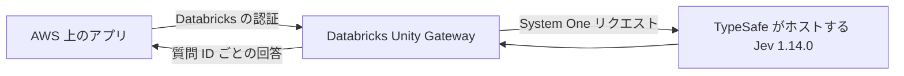

# AWS 上の Databricks Unity Gateway から TypeSafe AI の Jev を使用する

AWS 上の Databricks ワークスペースから、**Unity Gateway 経由で TypeSafe の Jev 1.14.0** を呼び出す。AWS 側のアプリから Databricks の認証で利用する構成。問い合わせの判定例には [Jev API の Tip](../77/) と同じ入力を使う。

## 📑 目次

- [アーキテクチャ](#-アーキテクチャ)
- [AWS での利用経路](#-aws-での利用経路)
- [使用方法](#-使用方法)
- [実行結果](#-実行結果)
- [開発者向け情報](#-開発者向け情報)
- [参考サイト](#-参考サイト)

## 🏗️ アーキテクチャ



## 🧩 AWS での利用経路

| 利用経路 | モデルとアクセス方法 |
| --- | --- |
| **Databricks Unity Gateway** | TypeSafe がホストする Jev 本体。アカウントのプレビューを有効化し、Databricks の権限と認証で呼び出す |
| **Amazon Bedrock AgentCore Evaluations** | AWS の公式例は、Lambda のカスタム評価器から TypeSafe の API を呼び出す構成 |
| **Amazon SageMaker AI** | AWS 上に自分でモデルを配備する用途では、Strands Decider を使える |

Bedrock の基盤モデル一覧では TypeSafe Jev の掲載を確認できなかった。この Tip は Unity Gateway を使う。推論は TypeSafe が実行し、入力データには TypeSafe の利用条件が適用される。専用の閉域配備が必要なケースでは、データの処理場所と接続先を確認する。

## 🚀 使用方法

1. AWS 上の Databricks ワークスペースを用意する。アカウント管理者が TypeSafe AI Models のプレビューを有効化し、実行するユーザーまたはサービスプリンシパルが対象モデルサービスを利用できることを確認する。[Databricks の Jev 提供条件](https://docs.databricks.com/aws/en/machine-learning/foundation-model-apis/supported-models)

1. GNU Make、uv、Python 3.11 以降を使える環境で、リポジトリのルートから Tip のディレクトリに移動する。

    ```bash
    cd nlp_processing/82
    make setup
    make install
    ```

1. `.env` の `DATABRICKS_HOST` に AWS 上の Databricks ワークスペースの HTTPS URL を設定する。パスは含めない。`DATABRICKS_TOKEN` に、そのワークスペースの OAuth アクセストークンを設定する。ワークスペースで許可されている場合は PAT も使える。

1. サンプルを実行する。入力を変える場合は `MESSAGE` を指定する。

    ```bash
    make run
    make run MESSAGE='登録したメールアドレスを変更したいです。'
    ```

## 📊 実行結果

`make run` は API の応答を JSON で標準出力に表示する。回答は `answers.refund_requested.noul`、`answers.department.choice`、`answers.urgency.score` に入る。サンプルで期待する部署は `billing`。リクエストには Unity Catalog のモデルサービス名を指定し、レスポンスの `model` にはバックエンドが報告したモデル ID が返る場合がある。

模擬 API で、`make run` が `.env` を読み込み、Gateway のルートに 3 種類の質問を送って JSON を返すことを確認した。認証情報の未設定、HTTP 429、JSON 以外の応答ではエラー終了を確認した。実ワークスペースの接続情報が未設定のため、Gateway 経由の実推論は未計測。

## 🛠️ 開発者向け情報

- [`Makefile`](Makefile) は `setup`、`install`、`run` を管理する。`make setup` は既存の `.env` を保持する。
- [`pyproject.toml`](pyproject.toml) と [`uv.lock`](uv.lock) で Python 環境を管理する。外部 Python パッケージは不要。
- [`run.py`](run.py) はワークスペースの `/ai-gateway/typesafe/v1/systemone` に、`model=system.ai.typesafeai-jev-1-14-0` を含むリクエストを送る。設定項目は [`.env.example`](.env.example) を参照。

## 🔗 参考サイト

- [AWS 上の Databricks が提供するモデルの一覧](https://docs.databricks.com/aws/en/machine-learning/foundation-model-apis/supported-models)
- [Databricks の System One API ガイド](https://docs.databricks.com/aws/en/machine-learning/model-serving/query-systemone-models)
- [Databricks の OAuth 認証ガイド](https://docs.databricks.com/aws/en/dev-tools/auth)
- [AWS Bedrock のモデル一覧](https://docs.aws.amazon.com/bedrock/latest/userguide/model-cards.html)
- [AWS の AgentCore Evaluations と Jev の接続例](https://aws.amazon.com/blogs/machine-learning/use-decision-models-with-amazon-bedrock-agentcore-evaluations/)
- [Strands Decider の SageMaker AI 配備ガイド](https://strandsagents.com/docs/user-guide/sdk/decision-models/models/sagemaker/)
